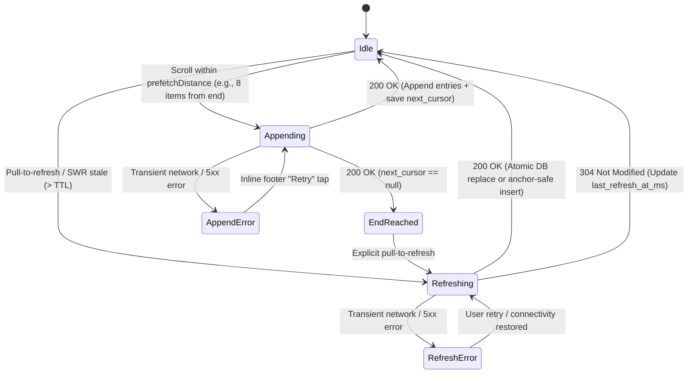
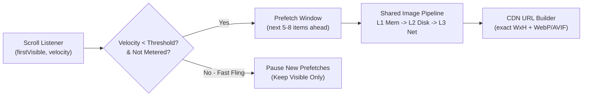

# Hands-On Drill #1: Offline-First Content Feed & Pagination Architecture

> **Parent Guide:** [1st Round Mobile System Design Prep Guide](./round1_mobile_system_design_guide.md) (expands on **Prompt 1** & **Day 4 Timed Drill**)  
> **Focus Areas:** Local persistence (SSOT), cursor pagination, cache invalidation & gap handling, media prefetching, and 60/120 FPS scrolling  
> **Target Level:** Senior Software Engineer (Mobile Foundation / Client Platform)

---

## 1. Drill Prompt, Scoping & Quantified Constraints (00–12 min)

### Interview Prompt
> *"Design the mobile client architecture for an offline-first content feed (text, images, and short video thumbnails) that supports infinite scroll, pull-to-refresh, optimistic user interactions (like/bookmark), and smooth 60/120 FPS scrolling across low-end and flagship devices. Assume multiple product surfaces (Home, Following, Topic feeds) will reuse this feed engine."*

Notice the **Foundation twist** in the last sentence: you are not building a one-off screen; you are designing a **reusable Feed Engine** shared by multiple surfaces.

### High-Leverage Clarifying Questions (Ask 3–5, Not All)

| Question to Ask | Why It Matters (What Changes in Your Design) | Default Assumption for This Drill |
| :--- | :--- | :--- |
| *"Can the same post appear in multiple feeds (Home, Following, Saved)?"* | Decides whether you normalize `feed_items` + `feed_entries` join table vs. a single flat table. | **Yes** — normalize posts from feed ordering so liking a post updates every feed instantly. |
| *"How long should cached feed content remain readable offline?"* | Drives disk cap, TTL policy, and gap-handling strategy on reconnect. | **Up to 7 days**, capped at **~100 MB** total (DB + media disk cache). |
| *"Are offline writes limited to lightweight toggles (like/bookmark) or full post creation?"* | Lightweight toggles can coalesce in an outbox; full posts need chunked media uploads + ID mapping. | **Like & bookmark toggles** offline (must survive process death and sync reliably). |
| *"What ordering model does the feed use — chronological or ranked?"* | Ranked feeds invalidate more aggressively and make opaque server cursors mandatory. | **Ranked / algorithmic feed** with opaque server-issued cursors. |
| *"Should we target low-end devices (2–3 GB RAM, 3G/flaky networks)?"* | Sets bitmap downsampling, prefetch throttling, and metered-network policies. | **Yes** — 128–256 MB Java heap budget, frequent 3G/Wi-Fi transitions. |

### Quantified Non-Functional Targets (NFRs)
- **Cold Start to Cached Feed:** `< 400 ms` (render cached first page from SQLite before network completes).
- **Frame Budget:** `16.6 ms` (60 Hz) / `8.3 ms` (120 Hz); `< 1%` slow frames, `< 0.1%` frozen frames (`> 700 ms`).
- **Disk Footprint:** Room DB `< 20 MB` (e.g., max 500–1,000 cached items per feed), Media Disk LRU `100 MB` (adaptive if device free space `< 500 MB`).
- **Memory Footprint:** L1 image cache capped at `15–20%` of app heap; in-memory paging window bounded (e.g., 60–100 items).
- **Resilience:** Zero data loss for offline likes/bookmarks across OS process death and app upgrades.

---

## 2. Local Persistence & Single Source of Truth (SQLite / Room)

A common mid-level mistake is storing a single flat `feed_items` table with a `position` column. That breaks as soon as two feeds (e.g., `HOME` and `FOLLOWING`) contain the same post or when a user likes a post in `HOME` and switches to `FOLLOWING`.

### Normalized Relational Schema (SSOT)

```sql
-- 1. Canonical post entities (deduplicated across all feeds)
CREATE TABLE posts (
    post_id         TEXT PRIMARY KEY,
    author_id       TEXT NOT NULL,
    body_text       TEXT NOT NULL,
    media_json      TEXT,              -- Compact metadata: url, width, height, blurhash, type
    like_count      INTEGER NOT NULL,
    server_liked    INTEGER NOT NULL,  -- 0 or 1 (last confirmed server state)
    updated_at_ms   INTEGER NOT NULL
);

-- 2. Per-feed ordering & membership (supports Home, Following, Topic feeds)
CREATE TABLE feed_entries (
    feed_id         TEXT NOT NULL,     -- e.g., "home", "following", "topic:tech"
    post_id         TEXT NOT NULL,
    rank_order      INTEGER NOT NULL,  -- Monotonic insertion index within this feed snapshot
    fetched_at_ms   INTEGER NOT NULL,
    PRIMARY KEY (feed_id, post_id),
    FOREIGN KEY (post_id) REFERENCES posts(post_id) ON DELETE CASCADE
);
CREATE INDEX idx_feed_entries_order ON feed_entries(feed_id, rank_order ASC);

-- 3. Pagination cursors & freshness metadata per feed
CREATE TABLE feed_remote_keys (
    feed_id             TEXT PRIMARY KEY,
    next_cursor         TEXT,          -- NULL means end-of-pagination reached
    etag                TEXT,          -- For conditional refresh (If-None-Match)
    last_refresh_at_ms  INTEGER NOT NULL
);

-- 4. Transactional Outbox for optimistic mutations (survives process death & refresh)
CREATE TABLE pending_actions (
    action_id       TEXT PRIMARY KEY,  -- Client UUID v7 (also serves as idempotency key)
    post_id         TEXT NOT NULL,
    action_type     TEXT NOT NULL,     -- "LIKE" | "UNLIKE" | "BOOKMARK" | "UNBOOKMARK"
    status          TEXT NOT NULL,     -- "PENDING" | "IN_FLIGHT" | "FAILED"
    retry_count     INTEGER NOT NULL DEFAULT 0,
    created_at_ms   INTEGER NOT NULL
);
CREATE INDEX idx_pending_actions_post ON pending_actions(post_id, created_at_ms DESC);
```

### Why This Schema Wins in a Senior Review

1. **Optimistic State Never Gets Clobbered by Background Sync:**
   - Instead of overwriting `posts.server_liked` directly on tap, the UI reads a reactive SQL view / `JOIN` between `posts` and the **latest pending action** in `pending_actions` for that `post_id`:
     - If a `PENDING` / `IN_FLIGHT` `LIKE` exists, effective `isLiked = true` (and `displayLikeCount = like_count + (if server_liked == 0 then 1 else 0)`).
     - When a network refresh upserts `posts`, it updates `server_liked` and `like_count` freely, while the local pending action still overlays the user's intent until the outbox drains!
2. **Coalescing Rapid Toggles (`LIKE → UNLIKE → LIKE` Offline):**
   - If the user taps Like, then immediately taps Unlike while offline, coalesce inside the same transaction: if an unsent `PENDING` opposite action exists for the same `post_id`, delete it instead of queuing redundant network calls.
3. **SQLite Performance & Concurrency:**
   - Enable **WAL (Write-Ahead Logging)** so UI reads on `Dispatchers.IO` never block while a background page insert commits.
   - Wrap every page write (`upsert posts` + `insert feed_entries` + `update feed_remote_keys`) in a **single `@Transaction`** so observers emit once per page rather than 20 times per page.
   - Run periodic orphan cleanup (`DELETE FROM posts WHERE post_id NOT IN (SELECT post_id FROM feed_entries) AND post_id NOT IN (SELECT post_id FROM pending_actions)`).

---

## 3. Cursor Pagination, State Machine & Cache Invalidation

### Why Opaque Cursor Pagination Beats `offset / limit`

Suppose the feed currently has posts `[P10, P9, P8, P7, P6]` and the client fetched Page 1 (`limit=3` → `[P10, P9, P8]`). While the user reads, two new posts `[P12, P11]` are inserted at the top:
- With **`offset=3, limit=3`**: server returns `[P9, P8, P7]` → **`P9` and `P8` are duplicated** in the user's feed.
- With **opaque keyset cursor** (`GET /v1/feed?feed_id=home&cursor=eyJyYW5rIjo4fQ&limit=20`): server resumes strictly after the cursor's anchor point and returns `[P7, P6, ...]` with **zero drift and zero duplicates**.
- Making the cursor **opaque** (base64-encoded server token) lets the backend evolve its ranking algorithm (chronological → ML score + tie-breaker ID) without shipping a client update.

### Pagination Coordinator State Machine



**Key Guardrails in the Coordinator:**
- **Single-Flight per `(feed_id, load_type)`:** Ignore duplicate `Appending` triggers while a page fetch is already in flight (guard with a `Mutex` or `AtomicBoolean`).
- **Refresh Cancels In-Flight Append:** If the user triggers pull-to-refresh while an append request is still running, cancel the append `Job` so stale cursor writes cannot race with the fresh snapshot.
- **Adaptive Page Size:** Fetch `pageSize = 20` on Wi-Fi, `pageSize = 10` on slow cellular/metered networks to keep time-to-first-byte low.

### Cache Invalidation & Gap Handling

This is where Senior Mobile Foundation candidates stand out. Cover all **four** scenarios explicitly:

1. **Cold Start — Stale-While-Revalidate (SWR):**
   - Immediately emit cached `feed_entries` from Room (`< 400 ms`).
   - Check `now - feed_remote_keys.last_refresh_at_ms`:
     - `< 5 min` (fresh): do nothing.
     - `>= 5 min` (stale): trigger a background refresh using `If-None-Match: <etag>`. If the server returns `304 Not Modified`, update `last_refresh_at_ms` with zero payload parsing or DB writes.
2. **The "2-Day Offline Gap" Problem:**
   - If the user returns after 48 hours and refreshes, the top 20 new posts do not overlap with the cached posts from 2 days ago.
   - **Option A (Atomic Snapshot Replace — recommended for ranked home feeds):** In a single DB transaction, delete old `feed_entries` for that `feed_id`, insert the fresh top 20 entries, and reset `next_cursor`. *(Never touch `pending_actions`!)*
   - **Option B (Gap-Marker Row — better for chronological timelines):** Keep cached items and insert a synthetic `GAP` row (`prev_cursor`, `next_cursor`) between the new head and old cache so the user can tap *"Load missed posts"* on demand.
   - *Interview tip:* State both options and pick **Option A** for a ranked feed (with **Option B** noted for chronological feeds).
3. **Scroll-Anchor Preservation (Zero Jarring Jumps):**
   - When a background SWR refresh brings in new items while the user is already scrolled down past index 0, **do not** force-scroll to top or silently shift the viewport.
   - Hold the new snapshot in a staging buffer (or anchor the `LazyColumn` / `RecyclerView` to the currently visible `post_id` + pixel offset) and display a floating **"New posts available"** pill. Commit/scroll to top only when the user taps the pill or explicitly pulls to refresh.
4. **Size- & TTL-Bounded Eviction:**
   - Run a lightweight `WorkManager` periodic cleanup (e.g., daily, `CHARGING` + `IDLE`) plus a soft cap on refresh: keep at most the **top 500 `feed_entries`** per feed and purge posts older than **7 days** unless referenced by `pending_actions` or `SAVED` bookmarks.

---

## 4. Image & Media Prefetching Pipeline

Even with a perfect Room + Cursor pagination layer, a feed feels sluggish if images pop in late or trigger GC pauses during fast scrolls.

### Architecture: Scroll-Aware Prefetcher + 3-Tier Cache



### Senior-Level Media Decisions

1. **Scroll-Velocity-Aware Prefetching:**
   - Maintain a sliding prefetch window of **5–8 items ahead** of the last visible item (in the current scroll direction).
   - **Fling Guard:** When scroll velocity exceeds a threshold (e.g., `> 3,000 px/s`), **pause** speculative prefetches and cancel queued off-screen requests so CPU decode threads and bandwidth are reserved for where the user actually lands.
   - **Prefetch Priority:** Tag prefetch requests as `LOW` priority and visible-viewport requests as `HIGH` priority in the image loader's dispatcher.
2. **CDN Negotiation & Zero Layout Shift:**
   - Require the feed API to return **`width`, `height`, and a tiny `blurhash` (or 20-byte thumbhash)** in `media_json`.
   - Reserve the exact aspect-ratio box *before* the image downloads → **zero layout shift (CLS)** and no `RecyclerView`/`LazyColumn` height recalculations mid-scroll.
   - Request server-resized assets matching the view's pixel width (`?w=720&fmt=avif,webp`) so a 3G device never downloads a 4 MB original for a 360dp card.
3. **Metered Network & Low-RAM Adaptation:**
   - Check `ConnectivityManager.isActiveNetworkMetered` and `RESTRICT_BACKGROUND_STATUS_ENABLED` (Data Saver): shrink prefetch window from 8 items to 2 (or 0) and disable video thumbnail autoplay on metered/3G connections.
   - On `ComponentCallbacks2.onTrimMemory(TRIM_MEMORY_RUNNING_LOW)`, halve L1 memory cache; on `TRIM_MEMORY_UI_HIDDEN`, clear L1 entirely while keeping L2 disk cache intact.
4. **Strict Lifecycle & Recycling Cancellation:**
   - Every image load binds to the item's composable lifecycle or `ViewHolder` tag. When a row scrolls off-screen and gets recycled, cancel its in-flight coroutine immediately so stale bitmaps never flash in reused cells.

---

## 5. Smooth Scrolling (60/120 FPS) & Main-Thread Hygiene

At **120 Hz**, every single frame has only **8.3 ms** for input handling, composition/binding, layout, and draw. One 12 ms JSON parse or synchronous disk read on the main thread drops two frames.

### Main-Thread Frame Budget Checklist

| Bottleneck | Why It Causes Jank | Senior Foundation Fix |
| :--- | :--- | :--- |
| **Unstable List Keys / Diffing** | Full re-composition or re-bind on every DB emission. | Use stable `post_id` keys (`key = { it.postId }` in `LazyColumn`, `areItemsTheSame` in `DiffUtil`); expose `@Immutable` UI models mapped on `Dispatchers.Default`. |
| **Heavy Text Layout** | Measuring long multi-line rich text (mentions, links, emojis) takes 3–6 ms per card on main thread. | Precompute text layout off-main-thread (`PrecomputedTextCompat` on Views; avoid complex dynamic `AnnotatedString` building inside composition). |
| **Image Decoding on UI Thread** | Decoding a 1080p JPEG takes 15–40 ms. | Decode & downsample strictly on a bounded CPU pool (`Dispatchers.Default.limitedParallelism(4)`), separate from network I/O (`Dispatchers.IO`). |
| **Nested Layouts & Overdraw** | Deep `ConstraintLayout` / nested `Column`/`Row` chains multiply measure passes. | Flatten item hierarchy; avoid nested vertical/horizontal measurement traps; recycle shared `RecycledViewPool` for horizontal carousels. |
| **Per-Card Analytics / Impression Calls** | Calling DB/network or allocating JSON on every bind spikes GC. | Track visibility (`> 50%` visible for `>= 1 s`) with lightweight viewport bounds checks, deduplicate in a `HashSet<String>` per session, and hand off to the Telemetry SDK's async buffer. |
| **Cold JIT Compilation** | First scroll after install drops frames while ART JIT-compiles hot paths. | Ship **Baseline Profiles** covering feed scroll, item bind, and Room query paths for AOT compilation. |

---

## 6. Failure Modes, Edge Cases & Observability

### Production Failure Mode Matrix

| Failure Scenario | What Goes Wrong If Ignored | Concrete Mitigation |
| :--- | :--- | :--- |
| **Process Death Mid-Scroll** | User returns to app and loses their place or sees empty screen. | Persist `feed_id` + anchor `post_id` in `SavedStateHandle`; Room SSOT immediately reloads cached feed around that anchor. |
| **Optimistic Like Fails Permanently (`403` / `404` deleted post)** | Infinite retry loop drains battery; UI stays out of sync forever. | On permanent `4xx`, mark `pending_actions.status = FAILED`, remove or reconcile the optimistic overlay, and surface a subtle non-blocking toast (*"Post is no longer available"*). |
| **Rapid Pull-to-Refresh Double-Tap** | Fires duplicate requests, races DB transactions. | Coalesce in-flight refresh via single-flight guard; ignore refresh triggers within a short debounce window (e.g., 1 s). |
| **Corrupt Cursor / Backend Schema Change** | Server returns `400 INVALID_CURSOR` on every append, permanently stranding pagination. | Detect `INVALID_CURSOR` error code → clear `feed_remote_keys` + `feed_entries` for that `feed_id` and automatically fall back to a clean initial refresh. |
| **Captive Portal Wi-Fi (Hotel/Airport)** | OS reports Wi-Fi connected, but requests hang or return HTML login pages. | Check `NET_CAPABILITY_VALIDATED` before draining outbox; enforce strict `10 s` connect / `15 s` read timeouts and schema validation before touching Room. |
| **Device Storage Critically Low (`< 100 MB` free)** | `SQLiteFullException` crashes the app during feed refresh. | Catch `SQLiteFullException`, evict L2 media disk cache + non-essential `feed_entries` first, and fall back to in-memory paging without crashing. |

### Observability, SLIs & Rollout Guardrails
- **Core SLIs (sliced by device tier, OS, network type):**
  - `feed_cache_ttfd_ms` (p50 / p95): time from screen open to first cached frame rendered.
  - `feed_page_load_ms` & `feed_page_error_rate`: broken down by `initial`, `refresh`, and `append`.
  - `feed_jank_frame_pct` & `feed_frozen_frame_pct`: collected via `JankStats` / `FrameMetricsAggregator`.
  - `media_cache_hit_ratio` (L1 / L2 / L3) & `prefetch_waste_ratio` (% of prefetched images never displayed — tune prefetch window if waste `> 40%`).
  - `outbox_drain_latency_ms` & `outbox_dead_letter_rate`.
- **Safe Rollout & Kill Switches:**
  - Gate aggressive features (e.g., predictive media prefetching, higher page sizes, video autoplay) behind remote config flags so you can dial back bandwidth or memory pressure instantly during an incident.

---

## 7. 60-Minute Hands-On Self-Drill & Senior Grading Rubric

### Timed Whiteboard Protocol
Run this drill solo on a blank canvas (Excalidraw / paper) while speaking out loud:

- [ ] **00–12 min (Clarify & Budgets):** Ask 4 clarifying questions, lock down multi-feed reuse, offline window (7 days), ranked ordering, and low-end device budgets (`16.6/8.3 ms` frame, `100 MB` disk, `256 MB` heap).
- [ ] **12–25 min (Architecture & Schema):** Draw the full client diagram (UI → Feed Facade → Pagination Coordinator + Outbox Worker → Room SSOT + 3-Tier Image Pipeline) and write the 4-table Room schema (`posts`, `feed_entries`, `feed_remote_keys`, `pending_actions`).
- [ ] **25–48 min (Pick 3 Deep Dives):**
  1. Walk through **cursor pagination + 2-day offline gap handling + scroll-anchor preservation**.
  2. Walk through **optimistic like overlay + outbox coalescing + idempotency**.
  3. Walk through **scroll-velocity-aware media prefetching + 120 FPS frame-budget hygiene**.
- [ ] **48–55 min (Failure Modes & Telemetry):** Cover `INVALID_CURSOR` recovery, `SQLiteFullException`, process death, and 4 key SLIs (`cache TTFD`, `jank %`, `prefetch waste %`, `outbox dead-letter rate`).
- [ ] **55–60 min (Wrap-Up):** Summarize top 2 trade-offs (e.g., atomic refresh vs. gap marker; prefetch distance vs. bandwidth waste) and state what you'd build next (e.g., predictive ML prefetching or multi-account DB isolation).

### 5 Senior "Curveball" Follow-Up Questions (Practice Answering in < 90 Seconds Each)

1. ***"Product wants to add a 'Following' tab and a 'Bookmarks' tab that share posts with 'Home.' What breaks if we didn't normalize?"***
   - *Model answer:* A flat `feed_items` table duplicates post rows across tabs, causing inconsistent like counts and stale edits. Separating canonical `posts` from `feed_entries(feed_id, post_id, rank_order)` guarantees a single update reflects across every feed immediately via Room's reactive `Flow`.
2. ***"The backend team reports a 3× spike in CDN bandwidth after we shipped prefetching. How do you diagnose and fix it?"***
   - *Model answer:* Check `prefetch_waste_ratio` (prefetched bytes never rendered). Add a scroll-velocity fling guard to pause prefetching during fast flings, shrink prefetch distance from 8 to 3–4 items, disable prefetch on metered networks, and negotiate exact CDN resize dimensions + WebP/AVIF.
3. ***"A user likes a post offline, then logs out and another user logs into the same device. What happens?"***
   - *Model answer:* Never share an unscoped Room DB or outbox across accounts. Scope DB files (or wipe user-scoped tables + cancel `WorkManager` tags) atomically on logout so User A's pending mutations never execute under User B's auth token.
4. ***"Why not just use Jetpack Paging 3's `RemoteMediator` out of the box and call it done?"***
   - *Model answer:* `Paging 3` + `RemoteMediator` is a great foundation for Room-backed pagination and handles windowing/diffing well, *but* it does not solve multi-feed normalization, optimistic outbox reconciliation, scroll-anchor "New posts" pills, velocity-aware media prefetching, or `INVALID_CURSOR` recovery on its own. Mention how you would either wrap `RemoteMediator` inside a Foundation `FeedEngine` facade or build a thin custom coordinator with the exact same contracts.
5. ***"How do you test this offline-first feed engine before rolling out to millions of users?"***
   - *Model answer:* Unit-test the pagination state machine & outbox coalescing with fake clocks/dispatchers; run Room in-memory instrumentation tests for SQL join reconciliation and migrations; add Macrobenchmark tests with `FrameTimingMetric` to guard p95 scroll jank in CI; and roll out behind a staged remote flag monitoring `feed_cache_ttfd_ms`, `jank %`, and `outbox_dead_letter_rate`.

### Self-Grading Scorecard (Target: >= 4/5 on Every Axis)

| Axis | 3 / 5 (Mid-Level) | 5 / 5 (Senior Mobile Foundation) |
| :--- | :--- | :--- |
| **Schema & SSOT** | Flat table; overwrites fields directly on tap. | Normalized `posts` + `feed_entries` + `remote_keys` + `pending_actions` overlay; WAL + single-transaction page writes. |
| **Pagination & Gaps** | Mentions cursor pagination briefly. | Contrasts offset vs. opaque cursor, draws full state machine, handles 2-day offline gap, `304` SWR, and scroll-anchor pill. |
| **Media & 120 FPS** | "Use Glide/Coil and RecyclerView." | Velocity-aware prefetch window, blurhash aspect-ratio reservation, CDN negotiation, separate decode vs. I/O pools, Baseline Profiles. |
| **Resilience** | Mentions retries and offline cache. | Handles process death, `INVALID_CURSOR`, `SQLiteFullException`, account switch isolation, and permanent `4xx` rollback. |
| **Observability** | "Add logging and Crashlytics." | Names actionable SLIs (`cache TTFD`, `prefetch_waste_ratio`, `JankStats`, `outbox_dead_letter_rate`) and remote kill switches. |
