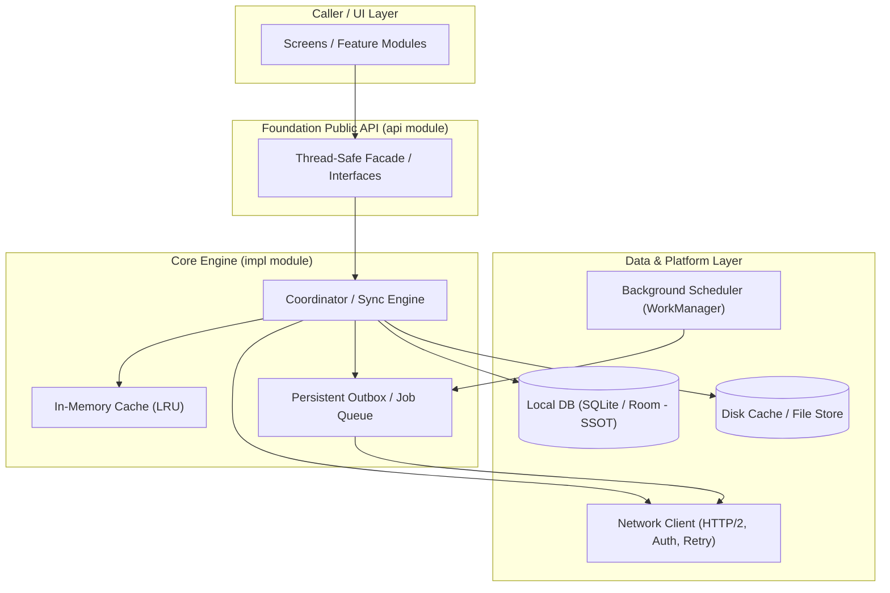
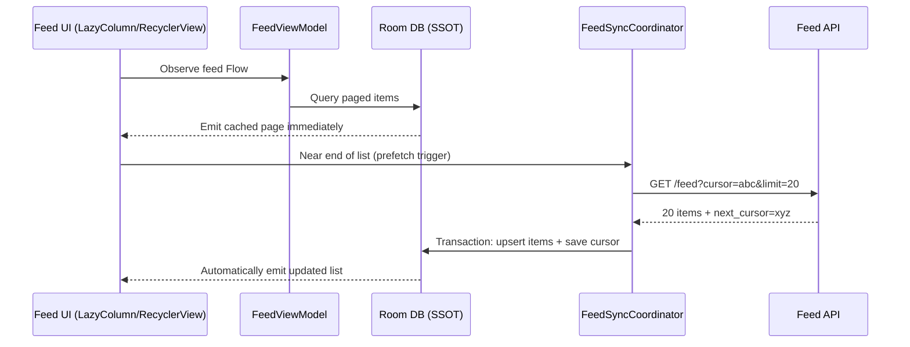
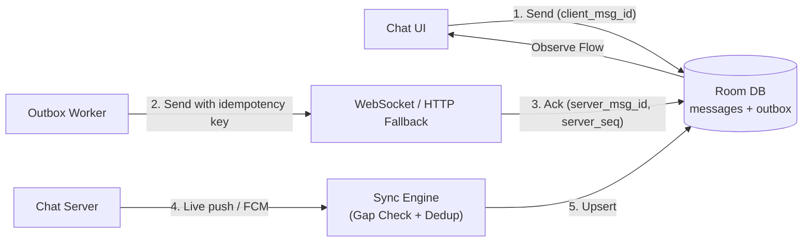
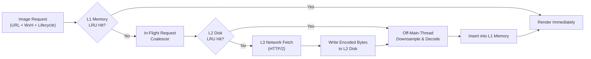

# 1st Round Mobile System Design Prep Guide (Senior Mobile Foundation)

> **Target Track:** 1st Round — 60-Minute Mobile System Design Interview  
> **Role Level:** Senior Software Engineer (Mobile Foundation / Client Platform)  
> **Primary Platform Lens:** Android (Kotlin) with cross-platform (iOS/shared-contract) awareness

---

## 1. What "Senior Mobile Foundation" Interviewers Actually Evaluate

A **Mobile Foundation** interview differs from a standard product-feature mobile interview. You are not just wiring up a screen; you are designing the **shared infrastructure, SDKs, runtime guarantees, and architectural guardrails** that dozens or hundreds of product engineers rely on—under strict mobile constraints (battery, memory, flaky networks, OS process kills, and diverse low-end hardware).

### Product Feature vs. Mobile Foundation Mindset

| Dimension | Product Feature Engineer | Senior Mobile Foundation Engineer |
| :--- | :--- | :--- |
| **Primary Consumer** | End users interacting with a feature | Both **end users** (performance, reliability) and **internal product engineers** (API ergonomics, safety, debuggability) |
| **Core Focus** | UI flows, screen state, API integration | Shared abstractions, offline sync engines, networking/caching layers, telemetry/config SDKs, startup & memory budgets |
| **Failure Handling** | Show an error state / retry button | Prevent cascading failures: backpressure, circuit breakers, disk/memory caps, single-flight auth refresh, kill switches |
| **Evolution & Rollout** | Ship feature behind a flag | Backward-compatible APIs, schema migrations, safe defaults, gradual rollout, observability before & after launch |
| **Performance Lens** | Smooth scrolling on one screen | Systemic budgets: cold-start time, main-thread jank (p95/p99), OOM rate, radio wake-ups, APK/binary size |

### Senior-Level Evaluation Rubric

To clear the Senior bar in 60 minutes, consistently demonstrate these five signals:

1. **Proactive Driving:** You structure the session, manage time, state assumptions explicitly, and ask high-leverage clarifying questions before drawing boxes.
2. **Client-Side Depth:** You go beyond generic backend boxes and reason concretely about SQLite/Room, Coroutines/dispatchers, process death, memory/disk caches, radio states, and OS background limits.
3. **Explicit Trade-Offs:** You never claim a design is "best." You compare 2–3 viable options (e.g., WebSocket vs. SSE vs. Push+Sync; LWW vs. server-authoritative merge) and justify your choice against the stated constraints.
4. **Production Readiness:** You proactively address failure modes (corrupt cache, token expiry storm, duplicate mutations, clock skew, low disk space) and observability (metrics, logs, alerts, kill switches).
5. **SDK & Team Scalability:** Where relevant, you design clean boundaries (API vs. implementation modules, thread-safe public interfaces, minimal transitive dependencies, testability).

---

## 2. The 60-Minute Interview Playbook

Use this pacing framework to avoid running out of time before reaching the senior-level deep dives.

| Time Window | Phase | Goal & Concrete Output |
| :--- | :--- | :--- |
| **00–05 min** | **1. Clarify & Scope** | Lock down functional scope (MVP vs. out-of-scope), target users/callers, and platform scope (Android only vs. Android + iOS shared contract). |
| **05–12 min** | **2. Non-Functional Requirements & Constraints** | Quantify scale, offline expectations, latency/freshness targets, device tier (low-end RAM/storage), battery/data limits, and reliability/consistency guarantees. |
| **12–25 min** | **3. High-Level Architecture & Data Contracts** | Draw the end-to-end client architecture (UI/Caller → Domain/Facade → Repository/Engine → Local Store & Network). Define key APIs, local DB schema, and data flow for 1–2 core use cases. |
| **25–48 min** | **4. Deep Dives (2–3 Core Areas)** | Pick the hardest 2–3 technical challenges (or ask the interviewer where they want to zoom in). Go deep on algorithms, concurrency, storage, caching, and edge cases. |
| **48–55 min** | **5. Failure Modes, Performance & Observability** | Cover process death, network flaps, disk-full, telemetry/SLIs, rollout/kill-switch strategy, and testing. |
| **55–60 min** | **6. Wrap-Up & Interviewer Q&A** | Summarize key trade-offs, call out what you would build next with more time, and ask 1–2 thoughtful questions. |

### High-Leverage Clarifying Questions Checklist

Ask 3–5 targeted questions (don't read a 15-item laundry list):

- **Scope & Users:** *"Are we designing an end-user feature (e.g., feed/chat) or a reusable internal SDK consumed by multiple feature teams?"*
- **Offline & Consistency:** *"Should reads and writes work fully offline? If offline writes are supported, what conflict resolution semantics are acceptable (last-write-wins, server-authoritative, or user-prompted merge)?"*
- **Freshness & Real-Time:** *"Does the data need sub-second real-time updates, near-real-time (seconds), or pull-to-refresh / periodic sync?"*
- **Scale & Constraints:** *"What payload sizes, event rates, or dataset sizes should we plan for? Are we targeting low-end devices (e.g., 2–3 GB RAM, 3G/flaky networks)?"*
- **Platform Boundary:** *"Should I focus on the Android client architecture and only sketch the server contract, or also design the backend APIs?"*

### Standard Client Architecture Diagram Template

When sketching the high-level architecture (minutes 12–25), organize layers cleanly from top to bottom so data flow and dependency direction are unmistakable:

---

## 3. Core Mobile Foundation Building Blocks

Master these 7 pillars—almost every Senior Mobile Foundation design prompt is a composition of 3–4 of them.

### 3.1 Networking & Resilience Layer

- **Transport:** Prefer **HTTP/2** (multiplexing over a single TCP connection, header compression) or **HTTP/3 (QUIC)** (0-RTT/1-RTT handshake, eliminates TCP head-of-line blocking, seamless connection migration across Wi-Fi ↔ cellular switches).
- **Serialization:** **Protobuf** (compact binary wire format, fast parsing, strong schema evolution via field tags) for high-volume/foundation traffic; JSON for simple/debuggable endpoints. Always enable **gzip / Brotli** compression for large payloads.
- **Single-Flight Auth Token Refresh:** When multiple concurrent requests get `401 Unauthorized`, guard the token refresh behind a `Mutex` / synchronized lock. Check if the token already changed while waiting; if so, retry immediately with the new token instead of firing N refresh calls (prevents a **token refresh storm**).
- **Retries & Backoff:**
  - Retry only **transient** errors (timeouts, `5xx`, `429 Too Many Requests` respecting `Retry-After`)—never retry `400/401/403/404`.
  - Use **exponential backoff with full jitter** (`random(0, min(cap, base * 2^attempt))`) to prevent thundering herds when a server recovers.
  - Require **idempotency keys** (client-generated UUID v4/v7) on all mutating `POST`/`PUT` requests so retries never create duplicate payments, messages, or orders.
- **Request Coalescing (Deduplication):** If 3 UI components request the same resource simultaneously, deduplicate in-flight requests by cache key and share the single `Deferred` result.
- **Circuit Breaker:** If a non-critical endpoint fails repeatedly (e.g., >50% failure over 10 requests), temporarily open the circuit to save battery, threads, and backend capacity, then probe in half-open state.

### 3.2 Local Storage, Caching & Offline-First Sync

- **Single Source of Truth (SSOT):** UI observes the local database (`Room` / `SQLite` returning `Flow<T>`). Network responses write to the local DB, which automatically emits updated state to observers. Never let UI merge network and DB states ad hoc.
- **SQLite / Room Best Practices:**
  - Enable **WAL (Write-Ahead Logging)** mode so concurrent readers are not blocked by writers.
  - Index foreign keys and sort columns (`(conversation_id, created_at DESC)`).
  - Run migrations defensively; always test destructive fallback policies (acceptable for pure caches, **never** acceptable for unsynced user mutations).
- **Offline Mutations — Transactional Outbox Pattern:**
  1. Write the optimistic local state **and** an outbox mutation record (`id`, `payload`, `idempotency_key`, `status`, `retry_count`, `created_at`) in a **single DB transaction**.
  2. A background worker (`WorkManager` with `NetworkType.CONNECTED`) drains the outbox in FIFO / dependency order.
  3. On server ack, reconcile the server-assigned ID/timestamp and delete the outbox row.
  4. On permanent `4xx` failure, mark as `FAILED`, roll back or flag in UI, and surface actionable recovery.
- **Pagination:** Use **cursor-based (keyset) pagination** (`after_cursor`, `limit`) rather than `offset/limit`. Offset pagination breaks (duplicates or skipped items) whenever new items are inserted at the top of a feed.
- **Conflict Resolution Strategies:**
  - **Last-Write-Wins (LWW):** Simple, uses server timestamps (never trust raw client clocks due to clock skew); risks silent overwrites.
  - **Field-Level Merge / Patch:** Send diffs (`PATCH`) instead of full objects so editing title offline doesn't clobber someone else's status change.
  - **Server-Authoritative with Version/ETag (`If-Match`):** Client sends `version`; server returns `409 Conflict` if stale, triggering client fetch-and-merge.
  - **CRDTs / Operational Transforms:** Needed only for true real-time collaborative editing (docs, whiteboards).
- **Cache Eviction:** Always bound caches by **both size and TTL** (e.g., 50–100 MB disk LRU + 7-day TTL) and respect OS storage pressure.

### 3.3 State Management, Concurrency & Lifecycle

- **Unidirectional Data Flow (UDF):** `Intent/Event → Reducer/UseCase → Immutable UiState (StateFlow)`. One-off side effects (navigation, snackbars) should be modeled as state (consumed via event ID) rather than fire-and-forget channels that can drop events during configuration changes.
- **Structured Concurrency (Kotlin Coroutines):**
  - `Dispatchers.Main` (UI only; never disk/network/JSON parsing).
  - `Dispatchers.IO` (blocking disk/network I/O; use `limitedParallelism(n)` to bound concurrency for heavy DB/file work).
  - `Dispatchers.Default` (CPU-bound work: decoding, compression, diffing, sorting).
  - Always bind coroutines to an explicit `CoroutineScope` (`viewModelScope`, app-level `SupervisorJob` scope for foundation singletons). Never use `GlobalScope`.
- **Process Death & State Restoration:**
  - Android can kill backgrounded app processes at any time while keeping the back stack alive.
  - Persist minimal navigation/filter keys in `SavedStateHandle`, and reload full data from the local DB (SSOT). Never rely on static singletons or in-memory caches surviving process death.

### 3.4 Real-Time, Push & Background Work

| Mechanism | Direction | Battery / Overhead | Best Fit |
| :--- | :--- | :--- | :--- |
| **Short Polling** | Client → Server | High (radio wake-ups) | Avoid on mobile except rare legacy fallback |
| **Server-Sent Events (SSE)** | Server → Client (HTTP) | Medium (single persistent HTTP stream) | Live scores, AI token streaming, order status updates |
| **WebSocket / gRPC Stream** | Bi-directional | Medium (keep-alive heartbeats) | Active chat, typing indicators, live collaboration (foreground only) |
| **Push (FCM / APNs)** | Server → Client (OS-managed) | Very Low (shared OS socket) | Background wake-ups, notifications, silent sync triggers |

- **Hybrid Real-Time Pattern:** Keep WebSocket open **only while the app is in the foreground**. When backgrounded, tear down the socket cleanly and rely on **FCM/APNs** to deliver notifications or trigger a lightweight background sync.
- **Gap Recovery on Reconnect:** WebSockets drop silently on mobile networks. Track `last_synced_seq_id` (or `last_synced_cursor`) locally; on every reconnect or app foregrounding, run a delta HTTP sync (`GET /sync?since=<seq>`) to fill any missed events before resuming live stream processing.
- **Background Execution Constraints:**
  - Respect **Android Doze Mode**, **App Standby Buckets**, and OEM background killers.
  - Use **`WorkManager`** for deferrable, guaranteed work (uploading telemetry, draining offline outbox, periodic cache cleanup) with constraints (`CONNECTED`, `BATTERY_NOT_LOW`).
  - Batch network requests to avoid repeatedly waking the cellular radio (radio tail energy lasts ~5–15 seconds per burst).

### 3.5 Observability, Telemetry & Experimentation

- **Three Pillars on Mobile:**
  1. **Metrics / Performance:** Cold/warm startup latency, frozen frames (>700ms), slow frames (>16.6ms), network latency/error rates, cache hit ratios, memory footprints.
  2. **Structured Logs & Breadcrumbs:** Ring buffer of recent user/system events attached to crash/ANR reports.
  3. **Distributed Tracing:** Propagate W3C `traceparent` headers from mobile requests to backend services to diagnose end-to-end latency.
- **Crash & ANR Diagnostics:**
  - Capture uncaught JVM exceptions (`Thread.UncaughtExceptionHandler`), native crashes (tombstones / Breakpad / Crashpad), and **ANRs** (`ApplicationExitInfo` on Android 11+, watchdog thread).
  - Always upload symbol/mapping files (`mapping.txt`, `.so` debug symbols) during CI builds for server-side deobfuscation.
- **Privacy & Compliance:** Scrub PII (emails, tokens, phone numbers, exact GPS) at the **ingestion boundary on-device** before writing to disk or uploading. Respect user opt-out / consent flags immediately.

### 3.6 App Startup, Performance & Modularity

- **Cold Start Optimization:**
  - Measure Time to Initial Display (TTID) and Time to Full Display (TTFD).
  - Move non-critical SDK initializations off `Application.onCreate()` into a lazy/async initialization DAG (e.g., AndroidX App Startup or custom phased initializer: `PRE_FIRST_FRAME` → `POST_FIRST_FRAME` → `ON_DEMAND`).
  - Use **Baseline Profiles** (AOT compilation of hot startup/scroll paths) and **R8 full mode** (shrinking, obfuscation, dex optimization).
- **Modularization at Scale:**
  - Split libraries into `:feature-api` (thin interfaces + models) and `:feature-impl` (concrete implementations + DI bindings) so changing an implementation does not trigger recompilation of upstream modules.
  - Enforce architectural boundaries via lint/static analysis (e.g., product modules cannot directly import `OkHttp` or `SQLite`; they must go through the Foundation networking/storage facades).
- **Foundation SDK API Design Principles:**
  - **Small surface area:** Expose interfaces, hide implementations (`internal` visibility).
  - **Safe by default:** Non-blocking calls (suspend functions / async callbacks), bounded memory/disk, fail-open behavior (a crashing analytics SDK must never crash the host app).
  - **Evolvable:** Explicit config builders, `@Deprecated(replaceWith = ...)`, binary compatibility validation.

### 3.7 Security & Privacy Foundations

- **Secrets & Tokens:** Never store access/refresh tokens in plain `SharedPreferences` or unencrypted SQLite. Encrypt keys via **Android Keystore** (hardware-backed TEE/StrongBox where available) using **Tink** or Jetpack Security.
- **Transport Security:** Enforce TLS 1.2/1.3 (Network Security Config, disable cleartext traffic). If discussing **certificate pinning**, always mention the operational trade-off: pinning protects against rogue CAs/MITM, *but* rotating expired pins without a backup pin + remote config/forced-update strategy can brick older app versions.
- **Data at Rest:** Encrypt sensitive local DBs (e.g., SQLCipher) when storing financial, health, or private message data; weigh the CPU/startup overhead (~5–15% query cost) for non-sensitive caches.

---

## 4. High-Probability Senior Mobile Foundation Design Prompts

Practice these 6 prompts. The first two are classic full-system mobile designs; the last four are **signature Mobile Foundation / Client Platform** prompts.

---

### Prompt 1: Design an Offline-First Feed & Infinite Scroll System

**Prompt:** *Design the mobile architecture for a high-traffic home feed (text, images, video thumbnails) supporting infinite scroll, offline reading, pull-to-refresh, and optimistic user actions (like/bookmark).*

#### 1. Key Requirements
- **Functional:** Scroll smoothly at 60/120 FPS, paginate infinitely, read previously loaded items offline, like/bookmark offline and sync later, refresh new items without jarring scroll jumps.
- **Non-Functional:** Fast cold start (<500ms to cached feed), bounded disk cache (e.g., 100 MB), low data/battery usage on metered networks, resilient to process death.

#### 2. High-Level Architecture
- **SSOT:** Local Room DB stores `feed_items` + `remote_keys` (next/prev cursors) + `pending_actions` (outbox).
- **Pagination Coordinator:** `RemoteMediator`-style coordinator triggers network fetch when scroll reaches `prefetchDistance` (e.g., 5–10 items from bottom).
- **Media Pipeline:** Separate Image Loader with Memory LRU + Disk LRU + scroll-aware prefetching & cancellation.
- **Optimistic Mutations:** Liking an item updates `feed_items.is_liked` + inserts into `pending_actions` in one DB transaction; `WorkManager` syncs with an idempotency key.

#### 3. Senior Deep-Dive Topics
- **Preventing Scroll Jumps on Refresh:** Insert new items into DB, but keep the user's anchor item pinned and show a *"New posts available"* pill instead of forcibly snapping to index 0.
- **Cursor Invalidation & Gap Handling:** If the user is offline for 2 days and refreshes, the gap between top-of-feed and cached items may be huge. Clear stale `feed_items` + `remote_keys` atomically in a single transaction on full refresh while preserving `pending_actions`.
- **Impression Tracking at 120 FPS:** Track item visibility (>50% visible for >1s) using lightweight viewport callbacks, deduplicate by `(session_id, item_id)`, buffer in memory, and flush via the Analytics SDK—never fire a network call per visible card.
- **Memory & Jank Prevention:** Downsample images to exact view dimensions, avoid nested scrolling / heavy layout passes, precompute rich text layouts off the main thread where needed.

#### 4. Failure Modes & Trade-Offs
- **Duplicate/Stale Items:** Use stable server IDs as primary keys (`ON CONFLICT REPLACE`) and preserve local optimistic flags (`is_liked`) during server upserts if a pending outbox mutation exists for that item.
- **Pull-to-Refresh vs. Stale-While-Revalidate:** Show cached feed immediately on cold start, trigger background refresh if `now - last_fetch > TTL` (e.g., 5 min).

---

### Prompt 2: Design a Real-Time Chat / Messaging Client Architecture

**Prompt:** *Design the mobile client architecture for a 1:1 and group messaging app that works reliably over flaky networks, supports offline sending, guarantees message ordering, and delivers push notifications.*

#### 1. Key Requirements
- **Functional:** Send/receive text & media messages, offline queueing, delivery/read receipts (`sending → sent → delivered → read`), typing indicators, multi-device sync, push notifications.
- **Non-Functional:** Low latency (<300ms foreground), zero message loss, no duplicate messages, strict ordering within a conversation, battery-friendly background operation.

#### 2. High-Level Architecture
- **Local DB (SSOT):** Tables for `conversations`, `messages` (indexed by `(conversation_id, server_seq)`), `outbox_messages`, and `sync_state` (`last_synced_seq`).
- **Dual Transport:**
  - **Foreground:** Persistent **WebSocket** (or bidirectional gRPC stream) for real-time events + typing indicators.
  - **Background / Fallback:** **FCM/APNs** wake-up + **HTTP delta sync** (`GET /messages?since_seq=X`).
- **Media Upload Pipeline:** Upload attachment to object storage (chunked/resumable upload with pre-signed URL) *before* sending the message payload referencing `media_id`.

#### 3. Senior Deep-Dive Topics
- **Message Ordering & Clock Skew:** Never rely solely on client timestamps for global order. Assign a client-generated **UUID (`client_msg_id`)** and temporary local timestamp for optimistic display; once acknowledged, order canonically by the server-assigned monotonic **`server_seq`** per conversation.
- **Deduplication & Idempotency:** If a send succeeds on the server but the ack is lost before reaching the client, the client retries with the same `client_msg_id`. The server deduplicates by `client_msg_id` and returns the original `server_msg_id` + `server_seq`.
- **Gap Detection & Reconnection Sync:** When receiving a live WebSocket event with `server_seq = 105` while local `last_synced_seq = 101`, detect the gap (`105 > 101 + 1`), pause live cursor advancement, fetch `[102..104]` via HTTP delta sync, and apply in order.
- **Connection Lifecycle & Heartbeats:** App foreground → open WebSocket; send periodic lightweight ping/pong heartbeats (e.g., 30s) to detect half-open TCP sockets; reconnect with exponential backoff + jitter on drop; app background → close WebSocket after a short grace period (e.g., 15–30s) to save battery.

#### 4. Failure Modes & Trade-Offs
- **Large Group Fan-Out / Storm:** Coalesce rapid incoming DB writes into batched transactions (e.g., flush every 100ms or 50 messages) so the UI doesn't re-render 500 times per second after reconnecting from airplane mode.
- **End-to-End Encryption (if in scope):** Mention key management (Signal Protocol / Double Ratchet), local encrypted DB, and that push notification payloads must be encrypted or opaque (decrypted locally in a notification service extension / `FirebaseMessagingService`).

---

### Prompt 3: Design a Mobile Analytics, Logging & Crash Telemetry SDK *(Foundation Classic)*

**Prompt:** *Design a shared mobile telemetry SDK used by 20+ product teams to log analytics events, performance metrics, and non-fatal errors reliably without degrading app performance or battery.*

#### 1. Key Requirements
- **Functional:** Simple, type-safe API (`track(event)`), automatic context enrichment (app version, OS, device tier, session ID, network type), offline persistence, batched compressed uploads, schema validation, dynamic sampling/kill-switch.
- **Non-Functional:** **<1ms** main-thread cost per call (non-blocking), **zero host-app crashes** (fail-open), bounded disk usage (e.g., max 10–20 MB), battery-conscious uploads, strict PII protection.

#### 2. High-Level Architecture
1. **Public API Facade:** Accepts typed event objects, attaches monotonic timestamp + sequence number, immediately enqueues into a bounded lock-free / `Channel` in-memory buffer, and returns.
2. **Ingestion Worker (`Dispatchers.Default` / single-threaded serial dispatcher):**
   - Runs **PII scrubber / redaction rules** and **client-side sampling**.
   - Enriches with immutable session metadata.
   - Buffers in memory until micro-batch threshold (e.g., 20 events or 5s) → single batch insert into a **bounded SQLite queue** (ring buffer: evict oldest low-priority events when disk cap is reached).
3. **Uploader (`WorkManager` + foreground batch timer):**
   - Triggers when `batch_size >= 50 events` OR `flush_interval >= 30s` OR app moves to background.
   - Reads a batch, compresses with **gzip/zstd** (Protobuf payload), uploads via HTTP/2 with batch `idempotency_id`.
   - Deletes rows only on `2xx` (or drops poison batches on permanent `400`).

#### 3. Senior Deep-Dive Topics
- **Backpressure & Priority Tiers:** Define event priorities (`CRITICAL`: crashes/payments, `NORMAL`: product funnels, `LOW`: debug/verbose). Under disk pressure or prolonged offline mode, drop `LOW` events first before touching `CRITICAL` events.
- **Clock Skew Handling:** Record both wall-clock time (`client_ts`) and monotonic uptime (`elapsed_realtime_ms`), plus `sent_at_ts` at upload time. The server computes true event time as `server_receive_ts - (sent_at_ts - client_ts)` to correct misconfigured device clocks.
- **Process Crash Durability:** If the app crashes, in-memory buffered events are lost. Flush critical events (and crash payloads) synchronously to a small append-only file on disk inside the crash handler, then upload on the next cold start.
- **Preventing Infinite Telemetry Loops:** Never log SDK-internal network errors back into the same telemetry pipeline without a strict circuit breaker / separate internal health counter.

#### 4. Failure Modes & Trade-Offs
- **SQLite vs. Append-Only Log Files:** SQLite gives easy priority querying, atomic deletes, and crash safety (WAL); flat segment files give slightly faster sequential writes and simpler rotation. For most mobile SDKs, segmented append-only files (e.g., 256 KB per file, rotated & deleted after upload) or a dedicated lightweight SQLite DB both work—explicitly compare them!
- **Schema Governance:** Enforce typed event schemas (code-generated from Protobuf/JSON Schema) at compile time so product teams can't silently break downstream dashboards.

---

### Prompt 4: Design a Feature Flagging & Remote Configuration SDK *(Foundation Classic)*

**Prompt:** *Design a mobile Feature Flag & Experimentation SDK that supports instant kill switches, A/B testing, gradual rollouts, and zero cold-start blocking.*

#### 1. Key Requirements
- **Functional:** Type-safe flag reads (`getBoolean`, `getInt`, `getJson`), user/device targeting (app version, locale, user tier), deterministic A/B bucketing, exposure event logging, emergency kill switches.
- **Non-Functional:** **<1ms synchronous read** on cold start (zero network blocking), consistent flag values within a session (no mid-screen UI flicker), works offline, resilient to corrupt server payloads.

#### 2. High-Level Architecture
- **3-Layer Value Resolution Priority:**
  1. **Local Debug Override** (debug builds only, for QA/dev).
  2. **Activated Snapshot** (loaded synchronously from fast local store — e.g., memory-mapped file / `Proto DataStore` / binary blob — at startup).
  3. **Compile-Time Bundled Defaults** (generated from flag registry; guarantees safe fallback on first install or corrupt cache).
- **Fetch-and-Activate Lifecycle (Staged Activation):**
  - On app launch (async, off main thread), fetch latest config using **ETag / `If-None-Match`** (returns `304 Not Modified` if unchanged, saving bandwidth).
  - Validate schema and persist to **`pending_snapshot`** on disk.
  - **Do not hot-swap** active flags mid-session for UI-structural flags; promote `pending_snapshot → active_snapshot` atomically on the **next cold start** (preventing inconsistent half-old/half-new UX).
  - **Exception — Emergency Kill Switches:** Allow specific flags marked `realtime = true` (or pushed via silent FCM) to activate immediately to stop an active crash loop.

#### 3. Senior Deep-Dive Topics
- **Exposure Logging & Avoiding Sample Ratio Mismatch (SRM):**
  - Log an experiment exposure **only when the flag is actually evaluated** in the code path (not when the config is fetched!).
  - Deduplicate exposure events per `(session_id, experiment_id, variant)` in memory so calling `isEnabled()` inside a `RecyclerView` binder doesn't fire 1,000 duplicate exposures.
- **Client-Side vs. Server-Side Evaluation:**
  - *Server-side evaluation:* Client sends user/device attributes; server returns resolved `{flag_key: value}` map. Keeps payload small, hides targeting rules/competitor-sensitive logic, and ensures Android/iOS/Web parity.
  - *Client-side rule evaluation:* Server sends rules + salt; client hashes `hash(user_id + salt) % 100`. Works for offline targeting changes, but larger payload and risk of platform evaluation drift.
  - **Recommendation:** Prefer **server-side evaluation** for most consumer apps, with client-side caching + ETag.
- **Startup Latency Budget:** Avoid parsing a 2 MB JSON file synchronously on the main thread during `Application.onCreate()`. Store the snapshot in a compact binary format (Protobuf / FlatBuffers) or pre-parsed key-value map read asynchronously with a tight fallback.

#### 4. Failure Modes & Trade-Offs
- **Corrupt / Incompatible Payload:** Validate type & schema before committing `pending_snapshot`; if a flag's type changed unexpectedly (`Int` → `String`), fall back to the typed default and emit a non-fatal alert.
- **Crash-Loop Recovery (Safe Mode):** If the app crashes N times within 10 seconds of startup after activating a new config snapshot, automatically roll back to bundled defaults and report the incident.

---

### Prompt 5: Design an Image Loading & Media Caching Library *(Foundation Classic)*

**Prompt:** *Design a reusable Android/mobile image loading library (similar in role to Glide/Coil) that handles thousands of images in scrolling lists without OOMs or dropped frames.*

#### 1. Key Requirements
- **Functional:** Load images from URL/file/resource into views/composables, placeholder/error states, transformations (crop, blur, rounded corners), animated formats (WebP/GIF), prefetching, request cancellation.
- **Non-Functional:** Zero main-thread decoding, bounded memory & disk caches, fast cache hits (<5ms from memory), resilient to rapid scrolling and `onTrimMemory`.

#### 2. High-Level Architecture — 3-Tier Cache Pipeline
1. **L1 Memory Cache (Strong LRU + Active Resources WeakReference map):**
   - Keyed by `(url, target_width, target_height, transformations, format)`.
   - Sized to ~15–25% of available app heap (`ActivityManager.memoryClass`).
   - Fast synchronous hit on UI thread (returns `Bitmap` immediately, zero flicker).
2. **L2 Disk Cache (DiskLruCache, e.g., 100–250 MB):**
   - Stores encoded bytes (WebP/JPEG/AVIF) — **not** raw bitmaps (a raw 1080×1920 `ARGB_8888` bitmap is ~8 MB, whereas encoded WebP is ~80 KB).
   - Optionally stores downsampled/transformed bytes separately from source bytes.
3. **L3 Network Fetcher:**
   - Uses shared HTTP/2 client with **request coalescing** (if 3 views request the same URL, only 1 network download occurs).

#### 3. Senior Deep-Dive Topics
- **Downsampling & Memory Math:**
  - A 4000×3000 camera photo decoded at `ARGB_8888` (4 bytes/pixel) consumes `4000 × 3000 × 4 = 48 MB` of RAM!
  - Always read image bounds first (`inJustDecodeBounds = true`), calculate `inSampleSize` (power of 2) to match the target view's pixel size, and prefer `RGB_565` (2 bytes/pixel) for opaque thumbnails or hardware bitmaps (`Bitmap.Config.HARDWARE`) when CPU pixel access isn't needed.
- **Scroll Performance & Lifecycle Cancellation:**
  - Attach every request to the view/composable lifecycle and target slot. When a `RecyclerView` ViewHolder is recycled, **immediately cancel** the previous coroutine/request and tag the view with the new request ID to prevent stale images flashing in the wrong cell.
- **Memory Pressure Handling:**
  - Register `ComponentCallbacks2.onTrimMemory(level)`: evict 50% of L1 on `TRIM_MEMORY_RUNNING_LOW`, and clear L1 completely on `TRIM_MEMORY_UI_HIDDEN` or `TRIM_MEMORY_BACKGROUND`.
- **Format & CDN Negotiation:**
  - Append requested dimensions and supported formats (`Accept: image/avif, image/webp`) so the CDN resizes server-side and avoids downloading 4 MB originals on 3G.

#### 4. Failure Modes & Trade-Offs
- **Decode Thread Pool Starvation:** Separate **network I/O pool** (`Dispatchers.IO`) from **CPU decode pool** (bounded to `min(4, CPU cores)`) so slow network downloads never block local disk cache decodes.
- **Corrupt / Partial Disk Files:** Write to a `.tmp` file and atomically `rename()` on completion; if decoding throws, evict the corrupt disk entry and retry from network once.

---

### Prompt 6: Design a Resilient Networking & Offline Mutation Queue Framework *(Foundation Classic)*

**Prompt:** *Design a shared Foundation networking and offline-mutation framework for an app with multiple product domains (checkout, profile edits, messaging, uploads) operating on unreliable networks.*

#### 1. Key Requirements
- **Functional:** Unified HTTP client, automatic auth token injection & refresh, persistent offline mutation queue with ordering/dependencies, prioritization (interactive UI calls > background sync), observability hooks.
- **Non-Functional:** Survives app restarts/process death, prevents duplicate server mutations, avoids battery drain during prolonged outages, easy for product teams to adopt safely.

#### 2. High-Level Architecture
- **Interceptor Chain:** `Metrics/Trace → Auth Header → Compression → Network Call → Single-Flight 401 Refresh → Retry/Backoff`.
- **Persistent Mutation Engine:**
  - Stores typed serialized jobs (`job_id`, `group_key`, `idempotency_key`, `payload`, `priority`, `attempt_count`, `next_run_at`, `state`) in Room/SQLite.
  - **Group-Key FIFO Ordering:** Jobs with the same `group_key` (e.g., `cart_123` or `conversation_456`) execute strictly in order; independent groups execute in parallel up to a concurrency cap.
  - **Connectivity-Aware Scheduler:** Uses `ConnectivityManager.NetworkCallback` (foreground) and `WorkManager` (background) to pause draining while offline and wake up cleanly when connectivity returns.

#### 3. Senior Deep-Dive Topics
- **Head-of-Line Blocking in Offline Queues:** If Job A in `group_key = "profile"` fails permanently (`400 Bad Request`), don't let it block unrelated jobs in `group_key = "likes"`—and even within the same group, define clear **dead-letter / poison-pill** policies (move to `FAILED` after max retries or permanent `4xx`, notify domain handler).
- **Network Flapping & Captive Portals:** `NetworkCapabilities.NET_CAPABILITY_VALIDATED` helps avoid wasting retries on captive Wi-Fi portals (hotels/airports) that claim "connected" without actual internet access.
- **Dependency Ordering Across Mutations:** Example: *"Create Post"* returns `server_post_id`, and *"Attach Photo to Post"* depends on it. Support local placeholder IDs (`local_uuid`) mapped to `server_id` in a `id_mapping` table, resolved just-in-time before executing dependent jobs.
- **App Upgrades & Deserialization Safety:** Version every persisted job schema (`schema_version`). If an old job cannot be deserialized after an app update, log a telemetry error and route it to a dead-letter handler rather than crashing the background worker in a loop.

---

## 5. Back-of-the-Envelope Mobile Numbers & Budgets Cheat Sheet

Citing realistic mobile budgets naturally in your design shows strong senior intuition:

| Metric / Resource | Typical Budget / Rule of Thumb | Why It Matters |
| :--- | :--- | :--- |
| **Frame Time (60 Hz / 120 Hz)** | **16.6 ms** (60 Hz) / **8.3 ms** (120 Hz) | Any main-thread disk I/O, heavy JSON parse, or bitmap decode drops frames. |
| **Cold Start (TTID)** | **< 500 ms** (good) / **> 1.5–2 s** (poor) | Keep `Application.onCreate()` lean; defer non-critical SDK init. |
| **ANR Threshold (Android)** | **5 s** (input dispatch) / **10 s** (broadcast) | Never block main thread on locks held by I/O threads. |
| **App Heap (Low-End Device)** | **128–256 MB** Java heap (2–3 GB RAM device) | Cap L1 memory cache at ~15–25% of heap; downsample images. |
| **Bitmap RAM Formula** | `Width × Height × 4 bytes` (`ARGB_8888`) | 1080×1920 ≈ 8.3 MB; 4000×3000 ≈ 48 MB! |
| **Disk Cache Cap** | **50–250 MB** (adaptive to free space) | Always bound disk caches; check `StatFs` / available storage. |
| **Cellular Radio Tail Energy** | **~5–15 seconds** per network burst | Batch analytics/sync calls instead of trickling every 2 seconds. |
| **SQLite Write Throughput** | ~10–50 single-row commits/s vs. **10,000+ rows/s** inside 1 transaction | Always wrap bulk inserts/updates in a single DB transaction. |
| **Network Timeouts (Mobile)** | Connect: **10 s**, Read/Write: **15–30 s** | Too short fails on 3G; too long hangs threads and queues. |

---

## 6. Structured Study Plan (Runs Alongside the Programming Track)

Pair this schedule with your 1st Round Kotlin DSA prep so both tracks advance in parallel without burnout.

### Option A: 2-Week Intensive Plan (~45–60 min/day)

| Day | Focus Area | Concrete Deliverable |
| :--- | :--- | :--- |
| **Day 1** | Playbook + Building Blocks (3.1 Networking, 3.2 Storage/Sync) | Draw the Standard Client Architecture from memory; write out single-flight token refresh & outbox flow. |
| **Day 2** | Building Blocks (3.3 Concurrency/Lifecycle, 3.4 Real-Time/Background) | Review process death restoration, WebSocket vs. SSE vs. FCM, and `WorkManager` constraints. |
| **Day 3** | Building Blocks (3.5 Observability, 3.6 Startup/Modularity, 3.7 Security) | Practice explaining cold-start init DAGs, PII scrubbing, and API/Impl modularization. |
| **Day 4** | **Timed Drill #1 (60 min):** Prompt 1 — Offline-First Feed | Sketch diagram + data model + deep dives (cursor pagination, optimistic likes, scroll stability). |
| **Day 5** | Review Drill #1 + Patch Weak Spots | Compare against Prompt 1 blueprint; tighten weak sections (e.g., cache invalidation). |
| **Day 6** | **Timed Drill #2 (60 min):** Prompt 2 — Real-Time Chat Client | Sketch dual transport (WS + FCM), `server_seq` ordering, gap recovery, and outbox retries. |
| **Day 7** | Review Drill #2 + Rest / Light Cheat-Sheet Review | Re-read Section 5 budgets; practice talking through trade-offs out loud for 10 min. |
| **Day 8** | **Timed Drill #3 (60 min):** Prompt 3 — Telemetry & Crash SDK | Focus on Foundation lens: <1ms main-thread API, backpressure, clock skew, fail-open safety. |
| **Day 9** | **Timed Drill #4 (60 min):** Prompt 4 — Feature Flag & Remote Config SDK | Focus on cold-start snapshot, staged activation vs. kill switches, exposure deduplication. |
| **Day 10** | **Timed Drill #5 (60 min):** Prompt 5 — Image Loading & Caching Library | Focus on 3-tier cache, bitmap memory math, request coalescing, lifecycle cancellation. |
| **Day 11** | **Timed Drill #6 (60 min):** Prompt 6 — Resilient Networking & Offline Queue | Focus on interceptor chain, group-key FIFO ordering, poison pills, schema versioning. |
| **Day 12** | Cross-Cutting Deep Dive: Startup, Memory & Modularization | Practice answering: *"How would you reduce cold start by 30% and OOMs by 40% across a 50-engineer mobile org?"* |
| **Day 13** | Full Realistic Mock (60 min, spoken aloud on blank whiteboard/Excalidraw) | Pick 1 prompt randomly; enforce strict timeboxes (5 / 7 / 13 / 23 / 7 / 5 min). |
| **Day 14** | Light Review Only | Review Section 5 numbers + Section 8 Pre-Interview Checklist. Rest well. |

### Option B: 4-Week Steady Plan (~30 min/day)
- **Week 1:** Master Section 2 Playbook + all 7 Building Blocks in Section 3 (one pillar per day).
- **Week 2:** Prompts 1, 2, and 3 (1 day timed 60-min drill + 1 day review & refinement each).
- **Week 3:** Prompts 4, 5, and 6 (1 day timed 60-min drill + 1 day review & refinement each).
- **Week 4:** Two full spoken mock interviews + targeted polish on your weakest 2 topics (usually concurrency/sync edge cases or SDK API ergonomics).

### Solo 60-Minute Mock Protocol
1. Open a blank canvas (Excalidraw, Miro, or paper) and start a **60-minute timer**.
2. **Speak out loud** as if the interviewer is in the room—silent thinking hides communication gaps.
3. Check the clock at **12 min** (must be starting architecture), **25 min** (must be starting deep dives), and **48 min** (must be starting failure modes & observability).
4. Afterward, grade yourself 1–5 on: *Scoping*, *Diagram Clarity*, *Client-Side Depth*, *Trade-Off Rigor*, and *Failure Modes/Observability*.

---

## 7. Common Anti-Patterns & Red Flags

| Red Flag (Avoid) | Senior Mobile Foundation Alternative (Do This) |
| :--- | :--- |
| Jumping straight into drawing boxes in minute 1 | Spend 5–10 min clarifying scope, offline guarantees, scale, and constraints first. |
| Designing a backend system with a single box labeled "Mobile App" | Spend 80%+ of your time **inside** the mobile client: local DB, caches, threads, lifecycle, SDK APIs, and sync engine. |
| Saying *"I'll store it in SharedPreferences / memory"* | Specify storage by data profile: Room/SQLite (structured/queryable), Proto DataStore (small typed prefs), DiskLruCache (blobs), Keystore/Tink (secrets). |
| Ignoring process death and OS background kills | Explicitly show how state survives process death (SSOT in DB + `SavedStateHandle`) and how background work runs via `WorkManager`. |
| Treating retries as a simple `for` loop | Always specify transient vs. permanent errors, exponential backoff + jitter, idempotency keys, and circuit breakers. |
| Designing an SDK that blocks the main thread or crashes the host app | Guarantee non-blocking APIs, bounded memory/disk, fail-open error handling, and observability. |
| Listing buzzwords without trade-offs (*"We'll use GraphQL and CRDTs"*) | Pick the simplest mechanism that meets requirements and explain *why* you rejected the heavier alternative. |

---

## 8. Quick 10-Minute Pre-Interview Checklist

- [ ] **Timeboxes in mind:** `0–12` Clarify & NFRs → `12–25` High-Level Architecture → `25–48` Deep Dives → `48–55` Failure Modes & Observability → `55–60` Wrap-Up.
- [ ] **Default mobile-first reflexes ready:**
  - Single Source of Truth (local DB) + Unidirectional Data Flow.
  - Idempotency keys + exponential backoff with jitter + single-flight auth refresh.
  - Bounded caches (memory + disk LRU + TTL) + `onTrimMemory`.
  - Process death recovery + Doze/battery-friendly batching (`WorkManager`).
  - Zero main-thread I/O + fail-open SDK boundaries + PII scrubbing.
- [ ] **Communication habit:** State the *why* before the *what*, narrate trade-offs explicitly, and check in with the interviewer before diving deep (*"I see three interesting deep dives here: offline conflict resolution, memory/image caching, and telemetry backpressure—which would you like to explore first?"*).
