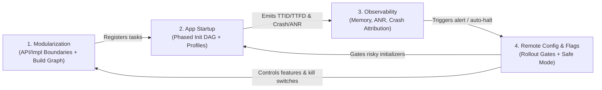
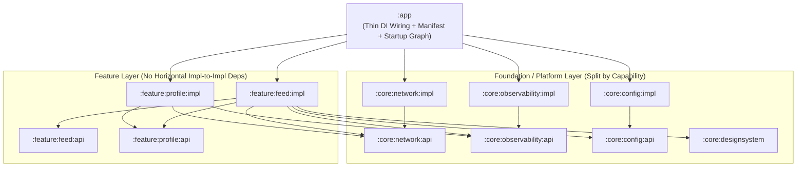
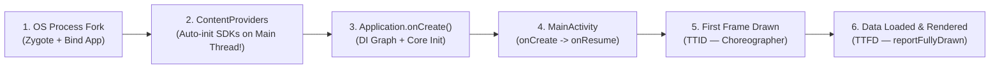
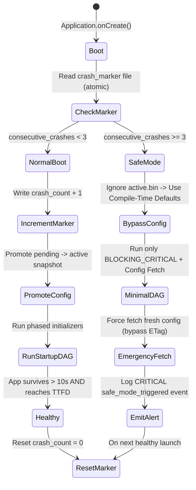

# Mobile System Design Deep Dive & Hands-On Drill: Modularization, Startup, Observability & Remote Config

> **Companion To:** [1st Round Mobile System Design Prep Guide](./round1_mobile_system_design_guide.md) (expands on Sections 3.5–3.6, Prompts 3–4, and Day 12 without repeating the general 60-minute playbook or baseline SDK sketches)  
> **Target Role:** Senior Software Engineer (Mobile Foundation / Client Platform)  
> **Format:** Deep-Dive Engineering Mechanics + End-to-End 60-Minute Case Study Drill + Pushback Q&A

---

## 1. How These Four Pillars Fit Together in a Mobile Foundation Interview

In a Senior Mobile Foundation interview, interviewers rarely test **Modularization**, **App Startup**, **Memory/ANR/Crash Observability**, and **Remote Config / Feature Flags** in isolation. Instead, they test whether you see them as **one closed-loop platform**:

- **Modularization** defines team boundaries, build speed, and architectural guardrails.
- **App Startup** controls what code is allowed to execute on the critical launch path across those modules.
- **Memory / ANR / Crash Observability** measures regressions and attributes them back to the exact owning module or flag cohort.
- **Remote Config & Feature Flags** act as the **safety control plane**—gradually rolling out risky changes, gating startup initializers, and tripping emergency kill switches or safe mode when observability detects a crash loop.



---

## 2. Hands-On 60-Minute Case Study Drill

Use this prompt for a realistic, timed 60-minute whiteboard session (following the timeboxes in [the parent guide](./round1_mobile_system_design_guide.md#2-the-60-minute-interview-playbook)).

### The Prompt

> *"You join as a Senior Mobile Foundation Engineer on a fast-growing Android app with 60 engineers and ~150 Gradle modules. Over the last 6 months:*
> 1. *Incremental build times crept up to 8–12 minutes, and teams constantly break each other's features.*
> 2. *Cold start TTID regressed from 650 ms to 2.3 s (p90).*
> 3. *ANR rate crossed 0.65% and background OOM/LMK kills spiked on 3 GB RAM devices.*
> 4. *A recent remote-config-gated SDK upgrade caused a startup crash loop for 4% of users until a hotfix shipped 2 days later.*
>
> *Design the **Mobile Foundation Architecture** across Modularization, Startup, Observability, and Remote Config to fix these issues and prevent them from recurring as the org scales to 120 engineers."*

### Minute-by-Minute Whiteboard Checkpoints

| Window | Focus | Concrete Output on Whiteboard |
| :--- | :--- | :--- |
| **00–05 min** | **Clarify & Scope** | Confirm platform scope (Android primary, shared contracts with iOS?), release cadence (weekly train?), min SDK (e.g., API 26+, meaning `ApplicationExitInfo` is available on API 30+), and whether dynamic feature modules (Play Feature Delivery) are needed. |
| **05–12 min** | **Budgets & SLIs** | Lock target budgets: Cold start TTID **< 500 ms (p50) / < 1.2 s (p90)**; ANR rate **< 0.25%**; Crash-free sessions **> 99.8%**; Incremental single-module build **< 30 s**; Safe-mode recovery **< 3 crashes**. |
| **12–25 min** | **Closed-Loop Architecture** | Draw the 4-pillar architecture: layered module graph → phased startup DAG → OS-level observability & attribution → remote config control plane with safe-mode breaker. |
| **25–48 min** | **Deep Dives (Pick 3)** | Go deep on: (A) `api`/`impl` module graph & Gradle compile avoidance, (B) Cold-start anatomy + Phased Init DAG + ContentProvider audit, (C) LMK/ANR attribution via `ApplicationExitInfo` + `SharedPreferences` trap, and (D) Startup crash-loop Safe Mode state machine. |
| **48–55 min** | **Rollout & Org Governance** | Explain how to migrate a live 60-engineer codebase incrementally (no big-bang rewrite), CI Macrobenchmark gates, and automated lint/dependency fitness checks. |
| **55–60 min** | **Trade-Offs & Wrap-Up** | Call out costs (extra boilerplate for `api`/`impl` split, DI graph complexity, binary size vs. AOT profiles) and what you'd tackle next. |

---

## 3. Pillar 1 Deep Dive: Modularization at Scale

The parent guide introduces the `:feature-api` / `:feature-impl` split. In a Senior Foundation interview, you must explain **why** naive modularization still produces slow builds and tight coupling, and how to enforce clean boundaries automatically.

### 3.1 Target Module Graph Topology

Keep the dependency graph **wide and shallow**, never tall and tangled:



### 3.2 Key Architectural Mechanics to Articulate

1. **Why `:core:common` Becomes a Bottleneck:**
   - A monolithic `:core:common` module imported by all 150 modules invalidates the Gradle build cache for the entire repo whenever anyone adds a single helper function.
   - **Fix:** Split core modules strictly by cohesive capability (`:core:network:api`, `:core:storage:api`, `:core:config:api`, `:core:time`), and keep `:api` modules pure Kotlin (no Android resources/R-class regeneration) whenever possible.
2. **Compile Avoidance (`implementation` vs. `api`):**
   - When `:feature:feed:impl` changes an internal class, Gradle's **ABI fingerprinting** sees no change to `:feature:feed:api`. Upstream modules depending only on `:api` skip recompilation completely.
   - Never leak transitive dependencies with `api(...)` unless the dependency's types appear in the module's public method signatures.
3. **Cross-Feature Navigation Without Circular Dependencies:**
   - `:feature:feed:impl` needs to open Profile without depending on `:feature:profile:impl`.
   - **Pattern:** `:feature:profile:api` exposes a lightweight route contract (e.g., `data class ProfileRoute(val userId: String) : AppRoute`). `:feature:profile:impl` binds its screen factory into a DI **multibinding map** (`@IntoMap` / Anvil `@ContributesMultibinding`) assembled in `:app`.
4. **Automated Architectural Fitness Functions (Enforcing Rules in CI):**
   - Humans forget conventions under deadline pressure; Foundation teams enforce them in CI:
     - **Dependency Guard / Module Graph Assert:** Fails PRs if any `:feature:*:impl` depends on another `:feature:*:impl`, or if a `:feature` module directly imports `OkHttp`, `Retrofit`, or `SQLiteDatabase` instead of `:core:network:api` / `:core:storage:api`.
     - **Binary Compatibility / Public API Dump:** Tracks public API changes in `:core:*:api` modules so Foundation teams don't accidentally break 20 feature teams.
     - **Explicit Visibility Mode (`explicitApi()`):** Forces Foundation `:api` modules to declare `public`/`internal` explicitly, preventing accidental API leaks.

### 3.3 Trade-Offs to Call Out
- **Over-modularization penalty:** Splitting into 500 tiny 2-file modules increases Gradle configuration time and DI graph generation overhead. Aim for **team-aligned feature boundaries** and **capability-aligned core modules**.
- **Migration strategy for a live monolith:** Do **not** pause feature work for a 6-month rewrite. Use the **Strangler Fig** approach: (1) ban new code in legacy `:app` via lint, (2) extract `:core:*:api` facades first, (3) peel off new features into `:feature:*:api` + `:impl`, (4) migrate high-churn legacy screens opportunistically.

---

## 4. Pillar 2 Deep Dive: App Startup Architecture

### 4.1 Exact Android Cold-Start Anatomy

Knowing the exact sequence before the first frame distinguishes a Senior engineer from a generic answer:



- **TTID (Time to Initial Display):** OS-measured time until the first frame of the launch Activity is drawn (skeleton/cached shell). Target: **< 500 ms (p50)**.
- **TTFD (Time to Full Display):** App-reported via `Activity.reportFullyDrawn()` once meaningful interactive content (e.g., cached feed items) is visible. Target: **< 1.0–1.5 s (p90)**.

### 4.2 Hidden Cold-Start Killers (High-Signal Senior Talking Points)

1. **The `ContentProvider` Auto-Init Trap:**
   - Many third-party SDKs (Crashlytics, WorkManager, Firebase, Ad SDKs) merge hidden `<provider>` entries into `AndroidManifest.xml` so they initialize automatically *before* `Application.onCreate()`—all **synchronously on the main thread**!
   - **Fix:** Audit the merged manifest (`build/outputs/logs/manifest-merger-*-report.txt`) in CI, disable rogue providers with `tools:node="remove"`, and route them through your controlled initialization DAG (or **AndroidX App Startup**).
2. **Eager DI Graph Instantiation:**
   - Injecting heavy singletons (`OkHttpClient`, `RoomDatabase`, `Gson`/`Moshi` reflection adapters) directly into `Application` forces them to initialize before the first Activity even starts.
   - **Fix:** Inject `Provider<T>` or `Lazy<T>` at startup boundaries so heavy objects instantiate on a background thread or on first use.
3. **Class Loading & Disk I/O on Main Thread:**
   - Reading `SharedPreferences` synchronously triggers an `fsync`/XML parse on disk; even calling `getSharedPreferences()` starts an async load that blocks the first `getString()` call until disk I/O finishes!
   - **Fix:** Pre-warm critical preferences asynchronously or use a compact binary snapshot (FlatBuffers/Protobuf/MMAP).

### 4.3 Concrete Whiteboard Design: Phased Initialization DAG

Instead of dumping 30 `sdk.init(this)` calls into `Application.onCreate()`, model startup as a **typed DAG** partitioned into 4 execution phases:

| Phase | When It Runs | Thread | Examples |
| :--- | :--- | :--- | :--- |
| **`BLOCKING_CRITICAL`** | Inside `Application.onCreate()` | Main Thread (strict **< 30 ms** total budget) | Crash/Safe-Mode guard, minimal DI root, StrictMode (debug) |
| **`ASYNC_PRE_FIRST_FRAME`** | Launched immediately in `Application.onCreate()` | Bounded Background Pool (`Dispatchers.Default`) | Remote Config snapshot load, Networking pool warm-up, Room DB pre-open |
| **`POST_FIRST_FRAME_IDLE`** | Triggered via `Looper.myQueue().addIdleHandler` / `Choreographer` after TTID | Background Pool | Analytics uploader, Push token sync, Experimentation refresh, WorkManager init |
| **`ON_DEMAND`** | First time a feature calls into the SDK | Caller's background scope | Maps SDK, Payment SDK, Video player engine, ML models |

#### Whiteboard-Ready Kotlin Contract

```kotlin
enum class StartupPhase {
    BLOCKING_CRITICAL,      // Strict budget (<30ms total) on Main
    ASYNC_PRE_FIRST_FRAME,  // Parallel background immediately
    POST_FIRST_FRAME_IDLE,  // Deferred until after TTID
    ON_DEMAND               // Never run during startup
}

interface StartupTask {
    val id: String
    val phase: StartupPhase
    val dependencies: Set<String> get() = emptySet()
    val requiredFlag: String? get() = null // Optional Remote Config gate
    suspend fun initialize(context: Context)
}
```

**Execution Engine Rules:**
- **Cycle & Phase Validation (CI/Unit Test):** Verify the DAG is acyclic via Kahn's algorithm (topological sort) and enforce a **phase invariant**: a `BLOCKING_CRITICAL` task may *never* depend on a `POST_FIRST_FRAME_IDLE` task.
- **Parallelism with Topological Barriers:** Tasks whose dependencies have completed run concurrently via `async` on a bounded dispatcher (`Dispatchers.Default.limitedParallelism(4)`), avoiding CPU oversubscription on 4-core low-end devices.
- **Per-Task Trace & Budget Enforcement:** Wrap every `initialize()` call in `Trace.beginSection("startup:${task.id}")` + monotonic timing. Emit per-task latency histograms to Observability; fail CI debug/benchmark runs if any `BLOCKING_CRITICAL` task exceeds 10 ms.

### 4.4 Compilation & CI Regression Prevention

- **Baseline Profiles + Startup Profiles:** Ship a `baseline-prof.txt` generated via Jetpack Macrobenchmark so ART **AOT-compiles** hot startup/navigation classes at install time (typically **20–40% cold-start reduction**). Startup Profiles also optimize **DEX layout** so startup classes sit in the primary `classes.dex`, reducing disk page faults.
- **R8 Full Mode:** Shrinks unused code, inlines single-implementation interfaces (which directly offsets the cost of `:api`/`:impl` modularization!), and reduces DEX size.
- **CI Macrobenchmark Gate:** Run cold-start Macrobenchmarks on a fixed reference device (or Firebase Test Lab) nightly and on release candidates; block release or auto-file a regression ticket if p50 TTID regresses by **> 5%**.

---

## 5. Pillar 3 Deep Dive: Memory, ANR & Crash Observability

Prompt 3 in the parent guide covers the *transport pipeline* (ring buffer, batching, gzip, PII scrubbing). This section focuses on **OS-level mobile diagnostics**—how a Foundation team actually detects, classifies, and attributes **OOMs, ANRs, and Crashes** in production.

### 5.1 Memory & OOM Observability (The LMK Blind Spot)

A classic junior mistake is saying *"I'll catch `OutOfMemoryError` in `UncaughtExceptionHandler`."* On Android, **most memory kills never throw a Java `OutOfMemoryError`!**

| Kill Mechanism | What Happens | How to Detect in Production |
| :--- | :--- | :--- |
| **Java Heap OOM** | App exceeds Dalvik/ART heap limit (`ActivityManager.memoryClass`, e.g., 192–512 MB); throws `OutOfMemoryError`. | `UncaughtExceptionHandler` (note: pre-allocate a small emergency buffer or minimal crash path so reporting itself doesn't OOM). |
| **Native Heap / Graphics Spike → OS LMK** | Native allocations (Bitmaps on API 26+, WebView, ExoPlayer, C++ libs) push total **PSS/RSS** over device limits; Android **Low Memory Killer (LMK)** sends `SIGKILL` **instantly with no callback**. | On **next cold start**, query `ActivityManager.getHistoricalProcessExitReasons()` (**Android 11+ / API 30+**) and inspect `reason == REASON_LOW_MEMORY`, `pss`, `rss`, and `importance` (foreground vs. background kill!). |
| **Pre-API 30 Fallback (Heuristic)** | `ApplicationExitInfo` unavailable. | **Session-End Breadcrumb Heuristic:** Persist an atomic `"foreground_clean_exit"` flag on `onStop()` + app version + crash marker. If next launch sees `was_foreground == true`, `no_crash_marker`, `no_os_upgrade`, and `last_trim_level >= TRIM_MEMORY_RUNNING_CRITICAL`, classify as **probable Foreground OOM (FOOM)**. |

**Proactive Memory Guardrails:**
- **Memory Watchdog Telemetry:** Sample `Runtime.totalMemory() - freeMemory()`, `Debug.getNativeHeapAllocatedSize()`, and `ActivityManager.MemoryInfo` at key lifecycle boundaries (post-TTFD, screen transitions, `onTrimMemory`).
- **Leak Detection in CI & Dogfooding:** Run **LeakCanary** in debug/dogfood builds and fail instrumentation UI tests if retained `Activity`/`Fragment`/`ViewModel` counts > 0.
- **Feature-Level Attribution:** Attach `current_screen` and `active_feature_module` to `ApplicationExitInfo` via `ActivityManager.setProcessStateSummary(byteArray)` (up to 128 bytes stored by the OS and returned verbatim alongside the LMK/ANR exit record!).

### 5.2 ANR Diagnostics & Root-Cause Attribution

Android triggers an ANR when the main thread cannot process an input event within **5 seconds** (or a BroadcastReceiver within 10s / ForegroundService start within 5–10s).

**Top 4 Production ANR Root Causes to Name-Drop:**
1. **Main-Thread Lock Contention:** Main thread calls `synchronized` or `Mutex` held by a background I/O thread doing disk/network work.
2. **The `SharedPreferences.apply()` Trap:** `apply()` writes asynchronously, *but* on `Activity.onStop()` / `Service.onDestroy()`, Android's `QueuedWork.waitToFinish()` **blocks the main thread** until every pending `SharedPreferences` `fsync` completes! Migrating hot prefs to **Proto DataStore** eliminates this class of ANR.
3. **Binder IPC Starvation:** Calling system services (`PackageManager`, `ConnectivityManager`, `TelephonyManager`) synchronously on the main thread when `system_server` is busy.
4. **Slow Disk / SQLite Contention:** Running unindexed queries or non-WAL writes blocking a main-thread read.

**How to Capture & Attribute ANRs:**
- **API 30+ (Authoritative):** Read `ApplicationExitInfo` with `reason == REASON_ANR` on next launch, and stream `info.traceInputStream` (the exact system-captured stack dump of all threads, including lock-holder attribution!).
- **All API Levels (Watchdog Thread):** A lightweight background thread posts a tiny runnable to `Handler(Looper.getMainLooper())` every 1–2s. If not executed within 4s (and debugger isn't attached), capture `Looper.getMainLooper().thread.stackTrace` + active screen + recent breadcrumbs.
- **Automated Team Attribution:** Parse the top non-framework stack frames (or lock-holder thread stack) → map package prefix (`com.app.feature.feed.*`) via a build-time **package-to-team ownership map** → auto-route alerts to the owning team's Slack/dashboard.

### 5.3 Distinguishing Startup Crashes from In-Session Crashes

Not all crashes are equal:
- **In-session crash** on a niche settings screen affects 0.05% of users—can wait for the next weekly train.
- **Startup crash** (crash within `< 10 s` of `Application.onCreate()`, before TTFD) **bricks the app** and prevents the user from even fetching a new remote config fix!

Track **Startup Crash Rate** as a separate P0 SLI alongside overall **Crash-Free Sessions**, and wire it directly into Pillar 4's Safe-Mode breaker.

---

## 6. Pillar 4 Deep Dive: Remote Config & Feature Flags as Safety Infrastructure

Prompt 4 in the parent guide covers the 3-layer value resolution (`Debug Override → Active Snapshot → Bundled Defaults`) and staged activation. Here is how Remote Config integrates with **Startup** and **Observability** to prevent the *"4% startup crash loop"* from our case study.

### 6.1 Solving the Startup Chicken-and-Egg Problem

**The Dilemma:** Some flags gate startup behavior itself (e.g., `use_new_http3_stack`, `enable_new_startup_dag`). You **cannot** wait for a network fetch during `Application.onCreate()`, yet you need consistent, fast (<1 ms) reads.

**Architecture:**
1. **Synchronous Snapshot Load (< 5 ms):** Store the active config snapshot as a compact **binary file** (Protobuf/FlatBuffers) rather than a large JSON file. Load it once into an immutable `ConcurrentHashMap` (or memory-mapped reader) during `BLOCKING_CRITICAL` / early `ASYNC_PRE_FIRST_FRAME`.
2. **Staged Activation (`pending_snapshot → active_snapshot`):**
   - Background fetch runs in `POST_FIRST_FRAME_IDLE` with `ETag` (`If-None-Match`).
   - Validates schema + types → writes atomically (`pending.tmp` → `rename` → `pending.bin`).
   - On **next cold start**, atomically promotes `pending.bin → active.bin` **before** feature initializers read flags.
3. **Kill-Switch Fast Path:** Flags tagged `activation = IMMEDIATE` (emergency kill switches) can update an in-memory overlay immediately upon background fetch or silent FCM push—*never* used for structural UI layouts, *only* for disabling broken background jobs, SDKs, or endpoints.

### 6.2 Concrete Whiteboard Design: Startup Crash-Loop Safe Mode

What if a newly activated config snapshot (`active.bin`, e.g., enabling a buggy SDK) causes the app to crash 2 seconds into launch—before `POST_FIRST_FRAME_IDLE` can fetch a kill switch?



#### Whiteboard-Ready Kotlin Sketch: `StartupSafetyGuard`

```kotlin
class StartupSafetyGuard(
    private val markerFile: File,
    private val crashThreshold: Int = 3,
    private val healthyWindowMs: Long = 10_000L
) {
    fun evaluateAtBoot(): Boolean {
        val count = readCrashCount()
        if (count >= crashThreshold) {
            return true // Enter Safe Mode!
        }
        writeCrashCountAtomic(count + 1)
        return false
    }

    fun markHealthyLaunch() {
        // Called once TTFD is reached AND uptime >= healthyWindowMs
        writeCrashCountAtomic(0)
    }

    private fun readCrashCount(): Int =
        runCatching { markerFile.takeIf { it.exists() }?.readText()?.trim()?.toInt() ?: 0 }
            .getOrDefault(0)

    private fun writeCrashCountAtomic(count: Int) {
        runCatching {
            val tmp = File(markerFile.parentFile, "${markerFile.name}.tmp")
            tmp.writeText(count.toString())
            tmp.renameTo(markerFile)
        }
    }
}
```

> **Why this impresses Senior interviewers:** It requires **zero network**, **zero SQLite**, and **< 1 ms** of I/O (a 4-byte file), runs *before* any third-party SDK or DI graph initializes, and guarantees the app can self-heal from a poisoned remote config or broken feature rollout without waiting 48 hours for an app-store hotfix.

### 6.3 Progressive Rollout & Automated Guardrail Gates

Tie Remote Config cohorts directly to Pillar 3 Observability:
1. Every telemetry event, crash, and startup trace includes a compact hash or list of **active experiment/flag cohorts** (`flag_cohort_ids`).
2. Rollout stages: `Internal Dogfood (100%) → 1% → 5% → 25% → 50% → 100%`.
3. **Automated Halt Rules:** If a flag cohort shows **+5% p90 TTID**, **+0.1% crash rate**, or **+0.15% ANR rate** compared to control over a minimum sample window, the config service **automatically halts or rolls back** the flag and pages the owning team.

---

## 7. Tough Interviewer Pushback & Follow-Up Q&A Drill

Practice answering these 8 follow-ups concisely (60–90 seconds each), always leading with the **trade-off**:

1. **Q: *"If we split every feature into `:api` and `:impl`, won't that double our Gradle modules and slow down Gradle configuration time?"***
   - **A:** Yes—if done blindly for tiny 2-class utilities, configuration overhead outweighs compile avoidance. Apply `:api`/`:impl` strictly at **cross-team boundaries** (features and shared core capabilities). Enable **Gradle Configuration Cache** and **Project Isolation** (or Bazel at very large scale) to keep configuration under a few seconds, and keep `:api` modules pure Kotlin (no Android plugin/resource merging).

2. **Q: *"How do you stop a product team from adding a heavy SDK back into `BLOCKING_CRITICAL` during startup?"***
   - **A:** Combine **technical gates** with **code ownership**: (1) `StartupTask` bindings in `BLOCKING_CRITICAL` require `CODEOWNERS` approval from Mobile Foundation, (2) a CI unit test enforces a strict allowlist of `BLOCKING_CRITICAL` tasks, and (3) nightly Macrobenchmarks attribute per-task startup duration and block regressions > 5%.

3. **Q: *"Why not just move ALL initialization to background threads in `Application.onCreate()`?"***
   - **A:** Two reasons: (1) **CPU contention**—spawning 25 background tasks simultaneously competes with the UI thread and RenderThread for CPU cores on 4-core low-end devices, *worsening* TTID! (2) **Ordering bugs**—if a screen opens and reads a database or config before its async initializer completes, you get race conditions or crashes. That's why we use a **bounded thread pool**, explicit **DAG dependencies**, and defer non-essential work until **after TTID (`POST_FIRST_FRAME_IDLE`)**.

4. **Q: *"Why did you mention `SharedPreferences.apply()` as an ANR cause when `apply()` is supposed to be asynchronous?"***
   - **A:** `apply()` writes to disk asynchronously on a background thread, *but* Android's `ActivityThread` calls `QueuedWork.waitToFinish()` on the **main thread** during `Activity.onStop()` and `Service.onDestroy()` to guarantee durability before process kill. If dozens of `apply()` calls or slow flash storage are queued, the main thread stalls > 5s and ANRs. Migrating high-frequency prefs to **Proto DataStore** (or batching writes off-main) eliminates this.

5. **Q: *"How do you measure OOMs accurately when Android's LMK kills the process without running `UncaughtExceptionHandler`?"***
   - **A:** On Android 11+ (API 30+), read `ActivityManager.getHistoricalProcessExitReasons()` on the next cold start and filter `REASON_LOW_MEMORY` with `importance == IMPORTANCE_FOREGROUND` (separating user-visible FOOMs from normal background reclamation). Attach the active screen/module via `setProcessStateSummary()`. On older OS versions, fall back to a session-end breadcrumb heuristic combined with `onTrimMemory` high-water marks.

6. **Q: *"What if `StartupSafetyGuard` itself gets triggered by a user force-killing the app 3 times quickly, instead of a real crash?"***
   - **A:** Great edge case. Two mitigations: (1) On API 30+, cross-check `ApplicationExitInfo` at boot—only increment or trip Safe Mode if the previous exit reason was `REASON_CRASH`, `REASON_CRASH_NATIVE`, or `REASON_ANR` (ignore `REASON_USER_REQUESTED` / `REASON_EXIT_SELF`). (2) Even if a false positive happens on older APIs, Safe Mode is **benign**—it simply falls back to compile-time defaults for one session, fetches fresh config, and resets once the session is healthy.

7. **Q: *"If a feature flag controls a UI layout, why not hot-swap it immediately when the background fetch finishes?"***
   - **A:** Hot-swapping mid-session causes **inconsistent UI state** (e.g., half the screens use the old navigation model and half use the new one) and **corrupts A/B experiment statistics** (Sample Ratio Mismatch / mixed-treatment sessions). Default to **staged activation on next cold start**, and reserve immediate activation strictly for **emergency kill switches** (disabling a crashing path or runaway network call).

8. **Q: *"You have 60 engineers shipping features every week. How do you roll out this Foundation architecture over 2 quarters without freezing product delivery?"***
   - **A:** Sequence by **highest leverage and lowest disruption**:
     - **Weeks 1–3 (Observability First):** Ship `ApplicationExitInfo` LMK/ANR tracking, TTID/TTFD traces, and Startup Crash Rate dashboards so every win is measurable.
     - **Weeks 4–6 (Stop the Bleeding):** Ship `StartupSafetyGuard` (Safe Mode) + Remote Config staged activation + audit/remove rogue `ContentProvider`s (often yields an instant 200–400 ms TTID win).
     - **Weeks 7–12 (Startup DAG & Profiles):** Introduce the phased `StartupTask` DAG, migrate top 10 slowest initializers to `POST_FIRST_FRAME_IDLE` / `ON_DEMAND`, and add Baseline + Startup Profiles with CI Macrobenchmark gating.
     - **Quarter 2 (Incremental Modularization):** Enforce dependency guardrails in CI, split `:core:common` by capability, require `:api`/`:impl` for all new features, and migrate the highest-churn legacy modules first.

---

## 8. Self-Scoring Rubric (After Your 60-Minute Drill)

Score yourself **1–5** on each dimension after running the Case Study Drill aloud on a blank canvas:

| Dimension | 5 (Strong Senior Signal) | 3 (Mid-Level / Needs Polish) |
| :--- | :--- | :--- |
| **Closed-Loop Thinking** | Explicitly connects Modularization → Startup DAG → Observability attribution → Remote Config Safe Mode. | Treats the 4 topics as disconnected checklists. |
| **Modularization Rigor** | Explains `api`/`impl` ABI compile avoidance, `:core:common` bottleneck, multibinding navigation, and CI dependency guards. | Just says *"split into feature modules"* without build/coupling mechanics. |
| **Startup Depth** | Traces `ContentProvider → Application → TTID → TTFD`, designs a bounded phased DAG, and cites Baseline/Startup Profiles + CI Macrobenchmarks. | Only says *"move things off main thread"* without addressing CPU contention or `ContentProvider`s. |
| **Observability Depth** | Distinguishes Java OOM vs. OS LMK (`ApplicationExitInfo`), names `SharedPreferences.apply()` / Binder ANRs, and designs package-to-team attribution. | Relies solely on `UncaughtExceptionHandler` and generic crash logging. |
| **Safety & Org Rollout** | Designs zero-network Safe Mode for startup crash loops, separates staged activation vs. kill switches, and proposes an incremental Strangler Fig rollout. | Assumes a big-bang rewrite or assumes remote kill switches always reach crashing clients. |
