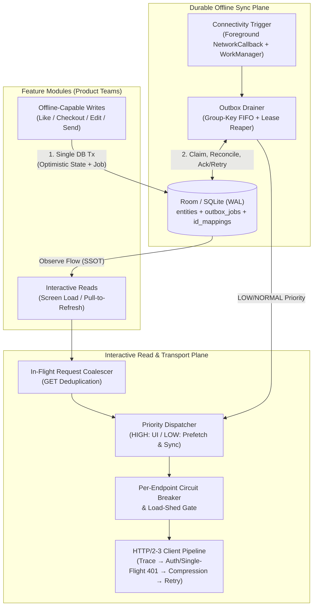
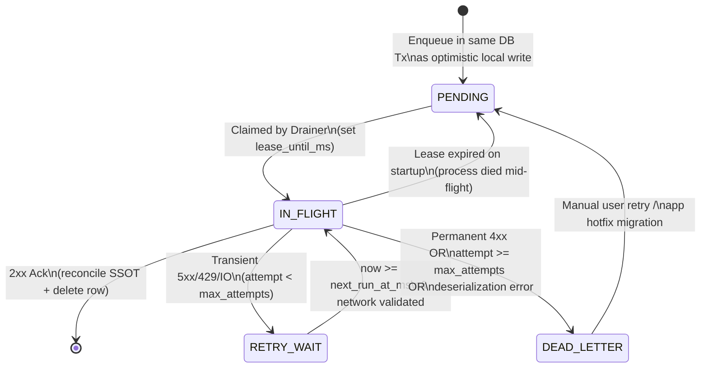
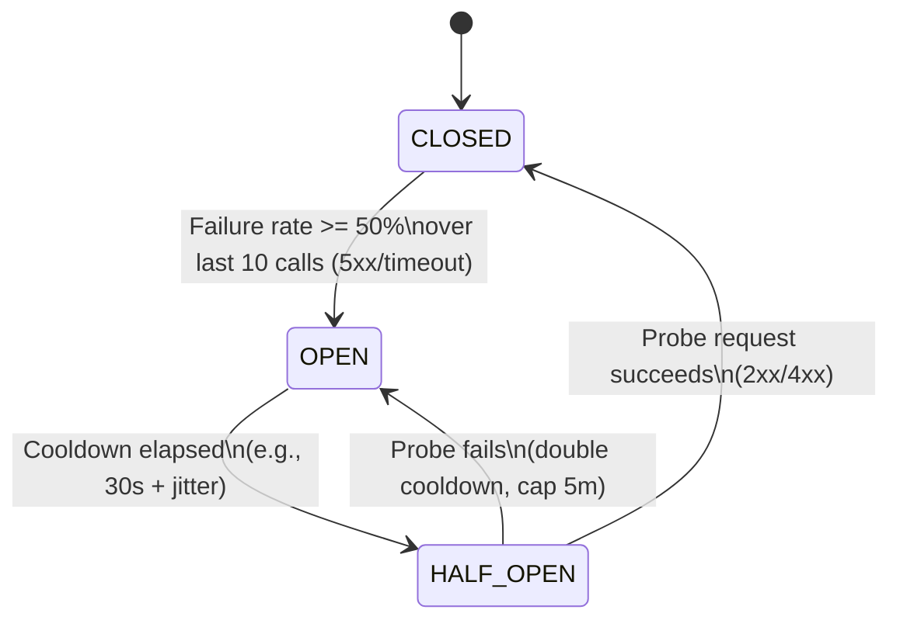

# Mobile System Design Drill: Networking, Background Sync & Reliability

> **Parent Guide:** [1st Round Mobile System Design Prep Guide](./round1_mobile_system_design_guide.md) (expands on Sections 3.1, 3.2, 3.4, and Prompt 6 without repeating the general playbook or rubric)  
> **Focus Areas:** Retry/Backoff & Idempotency · Request Deduplication & Prioritization · WorkManager & Offline Mutation Queue · API Evolution · Graceful Degradation & Circuit Breakers  
> **Format:** Hands-on 60-minute Senior Mobile Foundation case study, production patterns, Kotlin/SQLite sketches, and interviewer follow-up drill

---

## 1. Case Study Prompt (60-Minute Hands-On Drill)

> **Prompt:** *Design a shared **Mobile Networking & Reliable Sync Foundation SDK** for a multi-domain Android app (checkout/orders, messaging, profile edits, and media uploads). Product teams rely on it to make API calls and submit mutations that must work reliably on flaky 3G/4G/Wi-Fi networks, survive app kills and upgrades, protect the backend during outages, and respect battery and data budgets.*

### Concrete Scope & Non-Functional Targets

| Dimension | Target / Assumption (State Explicitly in Minutes 0–10) |
| :--- | :--- |
| **Consumers** | 15+ internal feature modules calling through a thin `:network-api` / `:sync-api` facade |
| **Read Latency** | Instant UI render from local SSOT; in-flight network reads deduplicated; interactive calls prioritized over background sync |
| **Write Durability** | **Zero lost mutations** across process death, airplane mode, and app restarts; **zero duplicate side effects** on server (idempotent) |
| **Background Execution** | Deferred sync via `WorkManager`; respects Doze Mode, App Standby Buckets, and metered networks |
| **Backward Compatibility** | App versions up to **12 months old** remain active in production; persisted offline jobs must survive app upgrades |
| **Degradation** | During partial backend outages (`5xx` / `429`), core flows degrade cleanly to cached reads without draining battery or amplifying server load |

### Tailored 60-Minute Drill Script

Use these checkpoints during solo practice (open a blank Excalidraw/whiteboard and speak aloud):

1. **00–10 min — Scope & Contracts:** Clarify read vs. write guarantees, strict ordering scope (per-entity/group vs. global), multi-device conflict policy, and whether mutations include large binary uploads.
2. **10–22 min — End-to-End Architecture:** Draw the two planes:
   - **Interactive Read/Write Plane:** `Caller → RequestCoalescer → PriorityScheduler → Interceptor Pipeline (Trace → Auth/Single-Flight Refresh → CircuitBreaker → Retry/Backoff → HTTP/2/3)`.
   - **Durable Offline Sync Plane:** `Caller → Local DB Transaction (Entity + Outbox Row) → Foreground NetworkCallback / Background WorkManager → OutboxDrainer → Same Network Client`.
3. **22–45 min — Pick 3 Deep Dives (based on interviewer cues):**
   - *Dive A:* Retry/backoff + idempotency + single-flight `401` refresh (preventing retry storms).
   - *Dive B:* Offline outbox schema, group-key FIFO ordering, dependency ID mapping, and `WorkManager` recovery after process death.
   - *Dive C:* API evolution + circuit breaker / load-shedding degradation.
4. **45–55 min — Failure Modes & Observability:** Walk through captive portals, poison-pill jobs, app-upgrade deserialization failures, and the 6 core SLIs.
5. **55–60 min — Trade-Offs & Testing Strategy:** Explain deterministic testing (fake clock, fake network interceptor, `WorkManagerTestInitHelper`, chaos/fault injection).

---

## 2. End-to-End Architecture Overview



---

## 3. Deep Dive 1: Retry, Backoff, Jitter & Idempotency

### 3.1 Error Classification Matrix

Never apply a blanket retry policy. Classify every failure before deciding whether to retry:

| Failure Category | Examples | Retry? | Action |
| :--- | :--- | :--- | :--- |
| **Transient Network** | `SocketTimeoutException`, `UnknownHostException` (while online), TCP reset | **Yes** | Exponential backoff + full jitter (bounded attempts) |
| **Rate Limited** | `429 Too Many Requests` | **Yes** | Honor `Retry-After` header (seconds or HTTP-date); fall back to jittered backoff if absent |
| **Server Transient** | `502`, `503`, `504`, `408 Request Timeout` | **Yes** | Exponential backoff + full jitter; feed failure into Circuit Breaker |
| **Auth Expired** | `401 Unauthorized` | **Once (via Single-Flight)** | Acquire auth refresh lock, refresh token once, replay original request; if refresh fails → logout & pause queue |
| **Permanent Client Error** | `400`, `403`, `404`, `422 Unprocessable Entity` | **No** | Fail immediately; for outbox jobs, route to `DEAD_LETTER` and notify domain handler |
| **Conflict** | `409 Conflict` / `412 Precondition Failed` | **No (Blind)** | Trigger domain conflict resolution (fetch latest server state, merge, or prompt user) |
| **TLS / Pinning Failure** | `SSLPeerUnverifiedException` | **No** | Abort immediately; emit security telemetry |

### 3.2 Exponential Backoff with Full Jitter & Single Retry Owner

When a backend recovers from an outage, synchronized retries from 1M clients create a **thundering herd** that knocks the backend down again. Use **Full Jitter**:

```text
cap_ms   = 60_000 (60s for foreground) or 300_000 (5m for background)
exp_ms   = min(cap_ms, base_ms * 2^attempt)
delay_ms = random(0, exp_ms)
```

> **Critical Foundation Rule — Single Retry Owner:**  
> Never stack retries across layers! If OkHttp retries 3×, a Retrofit call adapter retries 3×, and `WorkManager` retries 5×, a single failing request turns into `3 × 3 × 5 = 45` requests (**retry amplification**).
> - **Interactive `GET` calls:** Retry in the **HTTP transport layer** (max 2–3 attempts, tight total deadline e.g. 10–15s).
> - **Outbox mutations:** Disable transport-layer retries (0–1 immediate attempt) and let the **Outbox Scheduler / WorkManager** own all backoff and retry state persistently in SQLite.

### 3.3 End-to-End Idempotency Keys

Every mutating request (`POST`, non-idempotent `PUT`/`PATCH`) must carry a client-generated `Idempotency-Key` (UUIDv4 or time-ordered UUIDv7):

1. **Generate & persist before first send:** Store `idempotency_key` in the `outbox_jobs` row in the *same* DB transaction as the optimistic UI update.
2. **Reuse on every retry:** Even after process death or a lost `200 OK` response, the retry sends the **exact same** `Idempotency-Key`.
3. **Server contract:**
   - First receipt: server executes mutation, stores `(idempotency_key, request_hash, response_status, response_body)` with a TTL (e.g., 24–72h).
   - Duplicate receipt with same `request_hash`: server replays the stored response without re-executing side effects.
   - Duplicate receipt with different `request_hash`: server returns `422` / `409` (catches client bugs).

### 3.4 Single-Flight Auth Token Refresh (Zero Refresh Storms)

When an access token expires while 8 concurrent screen requests are in flight, all 8 receive `401`. Without synchronization, all 8 hit `/auth/refresh`, invalidating each other's rotating refresh tokens and logging the user out.

```kotlin
class SingleFlightTokenAuthenticator(
    private val tokenStore: TokenStore,
    private val authApi: AuthApi,
    private val sessionManager: SessionManager,
) {
    private val refreshMutex = Mutex()

    suspend fun refreshIfNeeded(failedAccessToken: String): String? {
        return refreshMutex.withLock {
            // Double-checked locking: another coroutine may have already refreshed
            val currentToken = tokenStore.getAccessToken()
            if (currentToken != null && currentToken != failedAccessToken) {
                return@withLock currentToken
            }

            val refreshToken = tokenStore.getRefreshToken() ?: run {
                sessionManager.forceLogout(reason = "missing_refresh_token")
                return@withLock null
            }

            when (val result = authApi.refresh(refreshToken)) {
                is AuthResult.Success -> {
                    tokenStore.saveTokens(result.accessToken, result.refreshToken)
                    result.accessToken
                }
                is AuthResult.Unauthorized -> {
                    // Refresh token revoked/expired: atomically clear session & pause sync
                    sessionManager.forceLogout(reason = "refresh_rejected")
                    null
                }
                is AuthResult.TransientError -> null // Let caller retry later; do NOT log user out!
            }
        }
    }
}
```

**Senior callout:** Notice the distinction between `AuthResult.Unauthorized` (permanent → logout & pause outbox) and `AuthResult.TransientError` (`503`/timeout → keep session intact, surface retryable error). Logging users out on a transient 503 during token refresh is one of the most common production bugs in mobile apps.

---

## 4. Deep Dive 2: Request Deduplication & Prioritization

### 4.1 Cancellation-Safe In-Flight Request Coalescing (`GET`)

When a home screen mounts, multiple independent widgets (header, banner, feed, badge) often call `getUserProfile()` simultaneously. **In-flight coalescing** shares one network call across all waiters.

**The subtle bug interviewers look for:** If Caller A starts the request, Caller B joins it, and Caller A's screen closes (cancelling Caller A's coroutine), a naive `async` tied to Caller A's scope will **cancel the network call for Caller B too**.

**Fix:** Run the upstream network call in a dedicated `SupervisorJob` scope, track active waiters with an `AtomicInteger`, and cancel the upstream `Deferred` **only when the last waiter cancels**.

```kotlin
class RequestCoalescer(
    private val upstreamScope: CoroutineScope, // App-level SupervisorJob + IO
) {
    private data class InFlight<T>(
        val deferred: Deferred<T>,
        val waiters: AtomicInteger = AtomicInteger(0),
    )

    private val active = ConcurrentHashMap<RequestKey, InFlight<Any?>>()

    @Suppress("UNCHECKED_CAST")
    suspend fun <T> execute(key: RequestKey, block: suspend () -> T): T {
        val entry = active.compute(key) { _, existing ->
            val current = existing ?: InFlight(
                deferred = upstreamScope.async {
                    try {
                        block()
                    } finally {
                        active.remove(key)
                    }
                }
            )
            current.waiters.incrementAndGet()
            current
        } as InFlight<T>

        return try {
            entry.deferred.await()
        } catch (ce: CancellationException) {
            // Only cancel the shared upstream call if NO other callers are waiting
            if (entry.waiters.decrementAndGet() == 0) {
                if (active.remove(key, entry)) {
                    entry.deferred.cancel()
                }
            }
            throw ce
        }
    }
}
```

**Key construction rules for `RequestKey`:**
- Include `(httpMethod, normalizedUrl, userIdOrAuthScope, relevantHeaders)` (e.g., `Accept-Language`, `X-Currency`).
- **Never** coalesce `POST`/`DELETE` mutations here—mutation deduplication belongs in the outbox layer.
- Remove the entry in `finally` so completed responses aren't leaked in memory (HTTP/Room caches handle post-completion caching).

### 4.2 Mutation Coalescing (Outbox Compaction)

For rapid user edits while offline (e.g., toggling a bookmark 5 times or editing a draft title 10 times):
- Assign a **`dedup_key`** (e.g., `"bookmark:item_42"` or `"draft_title:doc_7"`) to `PENDING` outbox rows.
- Before inserting a new `PENDING` job, check if an unstarted `PENDING` job with the same `dedup_key` exists:
  - **Replace/Merge:** Overwrite the payload with the latest state (or cancel out `ADD` + `REMOVE` pairs into a no-op).
  - **Never mutate an `IN_FLIGHT` row:** If a job is already in flight, enqueue the new mutation behind it in the same `group_key`.

### 4.3 Priority Lanes & Bulkheading

Without traffic isolation, a background sync draining 50 queued jobs or prefetching 30 thumbnails saturates OkHttp's per-host connection limit (`maxRequestsPerHost`, default 5) and starves a user tapping "Pay Now".

- **Lane 1 — `CRITICAL / INTERACTIVE`:** Auth, checkout, active screen reads. Dedicated permits (e.g., up to 6 concurrent calls).
- **Lane 2 — `NORMAL`:** User-initiated outbox mutations, pull-to-refresh. Bounded concurrency (e.g., 3 concurrent calls).
- **Lane 3 — `BACKGROUND / PREFETCH`:** Analytics batches, media prefetch, periodic delta sync. Strictly capped (e.g., max 2 concurrent calls) and **paused automatically** when a `CRITICAL` request is active or device is on low battery / metered data.

---

## 5. Deep Dive 3: WorkManager & Offline Mutation Queue

### 5.1 Local SQLite / Room Schema (WAL Mode Enabled)

```sql
CREATE TABLE outbox_jobs (
    job_id          TEXT PRIMARY KEY,          -- Client UUIDv7 (time-sortable)
    group_key       TEXT NOT NULL,             -- FIFO partition key, e.g. "order:123", "chat:456"
    dedup_key       TEXT,                      -- Optional key for coalescing PENDING edits
    idempotency_key TEXT NOT NULL UNIQUE,      -- Sent in HTTP Idempotency-Key header
    job_type        TEXT NOT NULL,             -- e.g. "CREATE_ORDER", "UPLOAD_PHOTO", "SEND_MSG"
    payload_version INTEGER NOT NULL,          -- Schema version for safe app upgrades
    payload_blob    BLOB NOT NULL,             -- Protobuf / JSON serialized mutation
    depends_on_id   TEXT,                      -- Optional parent job_id (must succeed first)
    priority        INTEGER NOT NULL DEFAULT 1,-- 0=HIGH, 1=NORMAL, 2=LOW
    state           TEXT NOT NULL,             -- PENDING | IN_FLIGHT | RETRY_WAIT | DEAD_LETTER
    attempt_count   INTEGER NOT NULL DEFAULT 0,
    max_attempts    INTEGER NOT NULL DEFAULT 8,
    next_run_at_ms  INTEGER NOT NULL,          -- Epoch ms when eligible for next attempt
    lease_until_ms  INTEGER,                   -- Detects orphaned IN_FLIGHT after process kill
    last_error_code INTEGER,                   -- For diagnostics & UI feedback
    created_at_ms   INTEGER NOT NULL
);

CREATE INDEX idx_outbox_sched ON outbox_jobs (state, next_run_at_ms, priority, created_at_ms);
CREATE INDEX idx_outbox_group ON outbox_jobs (group_key, created_at_ms);

-- Maps optimistic client IDs to server-assigned IDs for dependent mutations
CREATE TABLE id_mappings (
    local_id        TEXT PRIMARY KEY,
    server_id       TEXT NOT NULL,
    entity_type     TEXT NOT NULL,
    created_at_ms   INTEGER NOT NULL
);
```

### 5.2 Outbox Job Lifecycle State Machine



### 5.3 Ordering, Dependencies & Crash Recovery

1. **Group-Key FIFO Without Global Head-of-Line Blocking:**
   - The drainer selects at most **one** runnable job per `group_key` (specifically the oldest `created_at_ms` row in that group).
   - If the head job of `group_key = "chat:42"` is in `RETRY_WAIT`, other jobs in `"chat:42"` wait behind it, while `"chat:99"` and `"profile:me"` continue draining in parallel.
   - If the head job moves to `DEAD_LETTER`, mark dependent jobs in that chain as `BLOCKED` / `DEAD_LETTER` and surface an actionable banner to the user (e.g., *"Message failed to send — Tap to retry or discard"*).
2. **Dependent ID Resolution (`id_mappings`):**
   - Example: User creates a post offline (`local_post_1`) and attaches a photo (`UPLOAD_PHOTO` referencing `local_post_1`).
   - Job 1 (`CREATE_POST`) succeeds and returns `server_post_8842`. In one DB transaction: update local `posts` table, insert `("local_post_1" → "server_post_8842")` into `id_mappings`, and delete Job 1.
   - Before Job 2 executes, its payload resolver substitutes `local_post_1` with `server_post_8842`.
3. **Process Death Mid-Flight (Lease Reaper):**
   - If the OS kills the app while Job X is `IN_FLIGHT` (after sending HTTP request, before writing `200 OK` to SQLite), Job X would stay stuck forever without recovery.
   - Every time the drainer starts, it runs:  
     `UPDATE outbox_jobs SET state = 'PENDING', lease_until_ms = NULL WHERE state = 'IN_FLIGHT' AND lease_until_ms < :now`
   - Re-running Job X is safe because it reuses the exact same `idempotency_key`.

### 5.4 WorkManager & Connectivity Orchestration

| Path | Mechanism | Why |
| :--- | :--- | :--- |
| **Foreground Fast-Path** | `ConnectivityManager.NetworkCallback` (`NET_CAPABILITY_INTERNET` **and** `NET_CAPABILITY_VALIDATED`) | Immediately drains queued mutations when the user leaves a subway/tunnel; `NET_CAPABILITY_VALIDATED` avoids burning retries on hotel/airport captive portals. |
| **Background Guaranteed Path** | `WorkManager` `OneTimeWorkRequest` via `enqueueUniqueWork("outbox_sync", ExistingWorkPolicy.APPEND_OR_REPLACE, req)` | Survives app death and device reboots; OS batches radio wake-ups under Doze Mode. |
| **Urgent User-Visible Mutations** | `setExpedited(OutOfQuotaPolicy.RUN_AS_NON_EXPEDITED_WORK_REQUEST)` | Starts promptly when user backgrounds the app right after hitting "Submit Order", falling back gracefully if expedited quota is exhausted. |
| **Worker Result Mapping** | Return `Result.success()` once queue is empty; if jobs remain in `RETRY_WAIT`, schedule the next `OneTimeWorkRequest` with `setInitialDelay(earliestNextRunAt - now)` rather than holding the worker thread awake with `delay()`. | Never sleep inside a `CoroutineWorker`—it wastes wake locks and risks 10-minute `WorkManager` timeout cancellation. |

### 5.5 Pull Sync & Optimistic State Reconciliation

When pulling delta updates (`GET /sync?cursor=<last_cursor>` with `ETag` / `If-None-Match`):
- **Preserve local truth for in-flight entities:** Before overwriting a row in Room with server data, check whether `outbox_jobs` has a `PENDING`/`IN_FLIGHT` mutation for that `entity_id`. If yes, either skip overwriting the mutated fields or reapply the pending local diff on top so the UI never flickers back to stale server state.
- **Advance cursor atomically:** Upsert entities and update `sync_cursors.last_cursor` in the **same Room transaction**.

---

## 6. Deep Dive 4: API Evolution & Backward Compatibility

Unlike web apps where a deploy updates 100% of clients in minutes, mobile apps have a **long version tail** (users stay on older APKs for 6–18 months).

### 6.1 Wire-Level Evolution Rules

| Layer | Safe (Backward-Compatible) | Breaking (Avoid / Version) |
| :--- | :--- | :--- |
| **Protobuf** | Add new optional fields with new tag numbers; deprecate & `reserve` removed tags/names | Reuse a tag number; change field type (`int32` → `string`); change singular ↔ `repeated` |
| **JSON** | Add new nullable/optional fields; clients set `ignoreUnknownKeys = true` & `coerceInputValues = true` | Rename/remove required fields; change JSON type (`"123"` vs `123`) |
| **Enums** | Always map unknown values to `UNKNOWN` / `UNSPECIFIED = 0` on the client; design UI to ignore/hide unknown item types | Throw on unknown enum value (instant crash loop for all old clients when backend adds a new status!) |

### 6.2 Persisted Offline Job Evolution (App Upgrades)

What if a user queues a `CREATE_ORDER` job offline on **App v4.1**, updates to **App v4.2**, and then reconnects?
1. Tag every `outbox_jobs` row with `payload_version`.
2. Maintain **versioned decoders** (`v1 → DomainCommand`, `v2 → DomainCommand`) for at least N-2 releases (or as long as offline TTL allows, e.g., 30 days).
3. If a stored job cannot be deserialized even with fallbacks: **never crash the `WorkManager` worker** (which causes an infinite background crash loop). Catch the serialization exception, move the job to `DEAD_LETTER`, emit a high-severity telemetry event (`outbox_deserialization_failed`), and continue draining other jobs.

### 6.3 API Versioning & Deprecation Strategy

- **Prefer additive evolution** over frequent `/v1` → `/v2` path proliferation.
- Send **`X-App-Version`**, **`X-Platform`**, and **`X-Client-Capabilities`** (e.g., `webp,partial_sync_v2`) so the backend can negotiate features cleanly.
- Support **Deprecation & Force-Upgrade Signals**:
  - Soft deprecation: Server sends `Deprecation` / `Sunset` headers or remote config `recommended_min_version` → show dismissible update banner.
  - Hard cutoff: Server returns `426 Upgrade Required` (or remote config `hard_min_version`) → pause non-essential sync and present a blocking update screen.

---

## 7. Deep Dive 5: Graceful Degradation & Circuit Breakers

### 7.1 Scoped Client-Side Circuit Breaker

A failing non-critical microservice (e.g., `/v1/recommendations`) should never exhaust client threads, drain battery, or amplify load on a struggling backend.



- **Scope per endpoint group / service domain** (e.g., `recommendations`, `analytics`, `checkout`), **never** one global circuit breaker for the whole app.
- Count only **system failures** (`5xx`, timeouts, connection errors)—never trip the breaker on `400`/`404` business errors.
- While `OPEN`, fail fast locally (`CircuitOpenException`) in <1ms so callers immediately render cached/fallback UI.

### 7.2 Tiered Load Shedding & Degradation Policy

| Feature Tier | Examples | Behavior Under Backend Outage / Load Shed (`503` / `X-Load-Shed`) | Behavior Under Metered / Slow 3G Network |
| :--- | :--- | :--- | :--- |
| **Tier 0 — Core** | Auth, Checkout, Active Messages | Keep active with strict backoff + idempotency; never shed automatically | Allow normal execution; compress payloads (Protobuf/gzip) |
| **Tier 1 — Standard** | Home Feed, Profile, Search | Serve **stale Room SSOT cache** + subtle *"Offline / Showing cached data"* indicator; honor `Retry-After` | Reduce page size (`limit=10`), request lower-res CDN thumbnails |
| **Tier 2 — Opportunistic** | Prefetching, Auto-play Video, Debug Telemetry | **Shed completely** (drop or defer to `WorkManager` with `UNMETERED` constraint) | Disable prefetching & autoplay; increase telemetry batch interval (30s → 5m) |

### 7.3 Failure Mode & Recovery Matrix

| Failure Scenario | What Breaks Naively | Foundation Mitigation |
| :--- | :--- | :--- |
| **Token Refresh Storm** | 10 parallel `401`s fire 10 refreshes → refresh token invalidated → mass logouts | `Mutex` single-flight refresh + double-check token equality; never logout on transient `503` |
| **Captive Wi-Fi Portal** | `isConnected == true`, but every call returns HTML login page / TLS error → burns battery & trips breakers | Require `NET_CAPABILITY_VALIDATED`; detect non-JSON/unexpected content-type before tripping domain errors |
| **Process Kill Mid-Send** | Server commits mutation, client dies before `200 OK` → row stuck `IN_FLIGHT` or retried without idempotency (duplicate order!) | Startup lease reaper resets expired `IN_FLIGHT` → `PENDING`; retry reuses persisted `idempotency_key` |
| **Poison-Pill Outbox Job** | One malformed `400` job blocks the entire queue forever | Group-key isolation + permanent `4xx` / max-attempt `DEAD_LETTER` transition + domain rollback callback |
| **Backend `503` Recovery** | 1M offline devices reconnect simultaneously → thundering herd | Full jitter backoff + `Retry-After` enforcement + per-endpoint circuit breaker + Tier 2 load shedding |
| **Device Clock Skew** | User's clock is 2 hours behind → `next_run_at_ms` or token expiry math breaks | Use `SystemClock.elapsedRealtime()` for in-process durations/cooldowns; use server `Date` header offset for wall-clock comparisons |
| **Low Disk Space (`SQLiteFullException`)** | Outbox insert fails silently or crashes app | Catch `SQLiteFullException`, trigger emergency eviction of L2 image/HTTP caches first, then surface storage warning to user |

---

## 8. Observability, Testing & Senior Follow-Up Drill

### 8.1 Core Foundation SLIs (What to Dashboard & Alert On)

1. **Outbox Sync Lag (p50 / p95 / p99):** `ack_time - created_at_ms` (segmented by online vs. offline enqueue).
2. **Dead-Letter Rate:** `% of enqueued mutations ending in DEAD_LETTER` (grouped by `job_type` and `last_error_code`).
3. **Retry Amplification Ratio:** `total_http_attempts / unique_logical_requests` (alert if > 1.3× — signals retry storm or stacked retries).
4. **Coalescing Hit Rate:** `% of GET calls satisfied by an already in-flight request`.
5. **Auth Refresh Contention:** Refresh calls per user-session and refresh failure rate (distinguishing `401` vs `5xx`).
6. **Circuit Breaker Open Time & Radio Wake-Ups:** Duration each endpoint spends `OPEN`; network bursts per foreground/background minute.

### 8.2 Deterministic Testing Strategy (Foundation Bar)

- **Unit Tests:** Inject a fake `Clock` and deterministic `Random` into backoff & circuit breaker logic; test `RequestCoalescer` with `runTest` verifying that cancelling Caller A does *not* cancel Caller B's shared call.
- **SQLite / Room Migration & Crash Tests:** Use `MigrationTestHelper` for schema upgrades; simulate process death by inserting an expired `IN_FLIGHT` row and asserting the lease reaper recovers it cleanly.
- **WorkManager Integration Tests:** Use `WorkManagerTestInitHelper` + `TestDriver.setAllConstraintsMet(workId)` to verify chaining, backoff delays, and `ExistingWorkPolicy`.
- **Chaos / Fault Injection (Staging/Debug):** Built-in OkHttp debug interceptor that injects configurable latency, packet drops, `429 Retry-After`, `401` expiry, and `503` bursts so product teams can test degradation before release.

### 8.3 Rapid-Fire Interviewer Follow-Up Questions (Practice Aloud)

1. **"What if the server commits a payment, then the client loses connectivity before receiving the `200 OK`?"**  
   *Model answer:* The outbox job remains `IN_FLIGHT` (or transitions to `RETRY_WAIT` on timeout). When retried—even after a full app restart—it sends the same persisted `Idempotency-Key`. The server recognizes the key, does **not** charge again, and replays the original `200 OK` + `order_id`, allowing the client to reconcile its local DB and clear the outbox row.
2. **"Why not let OkHttp handle retries AND WorkManager handle retries?"**  
   *Model answer:* Multiplicative retry amplification (`3 × 5 = 15` attempts) drains battery and worsens backend outages. Assign a **single retry owner**: transport layer for short-lived interactive `GET`s, and the persistent outbox scheduler for durable mutations.
3. **"How do you prevent a buggy client release from DDoSing your own backend?"**  
   *Model answer:* Combine four guardrails: (1) full-jitter exponential backoff, (2) client-side circuit breakers honoring server `Retry-After` / `X-Load-Shed`, (3) strict request coalescing + retry-amplification monitoring, and (4) a remote-config **kill switch** (real-time via push/flag) to disable or throttle offending endpoints without waiting for a store release.
4. **"When would you choose `WorkManager` vs. a `ForegroundService` for sync?"**  
   *Model answer:* `WorkManager` is the default for deferrable, guaranteed outbox/delta sync because it cooperates with Doze Mode and requires no persistent notification. Use a `ForegroundService` (or `WorkManager` with `setForeground()`) only for user-initiated, long-running, immediately visible transfers like uploading a 500 MB video where the user expects live progress.
5. **"What happens if a user logs out while 10 mutations are still in `outbox_jobs`?"**  
   *Model answer:* Scope every outbox row by `user_id` (or wipe/quarantine user-scoped DB tables atomically on logout and cancel the unique `WorkManager` job) so User A's queued mutations are **never** accidentally sent with User B's auth token on a shared device.
6. **"Why use `NET_CAPABILITY_VALIDATED` instead of just checking `activeNetworkInfo != null`?"**  
   *Model answer:* `activeNetworkInfo` returns true on captive Wi-Fi portals and dead routers that have local link connectivity without real internet access. `NET_CAPABILITY_VALIDATED` confirms Android's connectivity probe actually reached the internet, preventing futile sync storms.

---

## 9. Self-Check Rubric (After Your 60-Minute Timed Run)

Score yourself `1–5` on each dimension:

- [ ] **Single Retry Owner:** Clearly separated interactive `GET` retries from persistent outbox retries (no stacked loops).
- [ ] **Concurrency Rigor:** Handled single-flight `401` refresh *and* cancellation-safe `GET` coalescing without leaks or deadlocks.
- [ ] **Durable Outbox Depth:** Drew a concrete Room schema with `idempotency_key`, `group_key`, `payload_version`, and lease-based crash recovery.
- [ ] **Mobile Platform Realism:** Explicitly addressed `WorkManager` constraints, Doze Mode, captive portals, radio wake-ups, and app-upgrade schema safety.
- [ ] **Degradation & Observability:** Scoped circuit breakers per domain, defined tiered load shedding, and named concrete SLIs (outbox lag, retry amplification, dead-letter rate).
